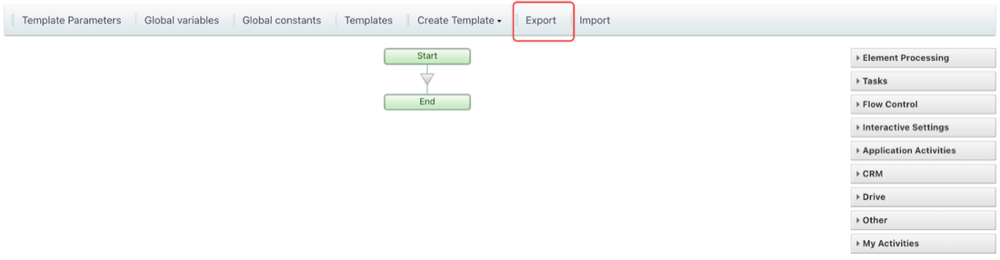

# Workflow Templates: Methods Overview



Choose a tool for developing with an AI agent:

- use [Alaio Vibecode](../../../ai-tools/vibecode.md) to build an app for Bitrix24 from a task description without knowing any programming language. The agent writes the code and deploys the app to a server, with no manual hosting setup
- use the [MCP server](../../../ai-tools/mcp.md) to develop a REST API integration in your own project. The agent refers to the official REST documentation



A workflow template defines automation logic through actions and operations in the workflow designer. The methods let you add a template from a `.bpt` file, update its parameters, retrieve the list of templates, and delete a template created by the application.

The methods work only with templates from the workflow designer. Templates of automation rules configured at the stages of CRM items and smart processes, or in tasks, are not available in the REST API: you cannot retrieve, update, or delete them.



An administrator can add, update, and delete templates within the context of an [application](../../../settings/app-installation/index.md). Only the application that created a template can update or delete it.



> Quick navigation: [All Methods](#all-methods)
>
> User documentation:
> - [How to Create a Sequential Workflow Template](https://helpdesk.bitrix24.com/open/6034961/)
> - [How to Configure Template Parameters](https://helpdesk.bitrix24.com/open/22522520/)

## How to Get Started

1. Add a template using the [bizproc.workflow.template.add](./bizproc-workflow-template-add.md) method
2. Retrieve the list of templates using the [bizproc.workflow.template.list](./bizproc-workflow-template-list.md) method
3. Update the template using the [bizproc.workflow.template.update](./bizproc-workflow-template-update.md) method
4. Delete an outdated template using the [bizproc.workflow.template.delete](./bizproc-workflow-template-delete.md) method

The `add` and `update` methods return the template identifier, `list` returns an array of up to 50 templates per page with the fields from `SELECT`, and `delete` returns `null` on success.

## How to Prepare a Template File

The [bizproc.workflow.template.add](./bizproc-workflow-template-add.md) method adds a template from a file with the `.bpt` extension. To get the file, configure the workflow template in the designer and export it.

The resulting file can be used as a template in any Bitrix24 instance.



- [Workflow Designer](https://helpdesk.bitrix24.com/open/6035031/)
- [Exporting and Importing Workflow Templates](https://helpdesk.bitrix24.com/open/8605753/)



## Document Type Identifier

`DOCUMENT_TYPE` is specified in the parameters of the [bizproc.workflow.template.add](./bizproc-workflow-template-add.md) method when the application adds a template from a file. In the [bizproc.workflow.template.list](./bizproc-workflow-template-list.md) method, the `MODULE_ID`, `ENTITY`, and `DOCUMENT_TYPE` values are returned in the template fields and can be used for filtering.

`DOCUMENT_TYPE` is an array of three strings. It links the template to the document type for which the workflow will run:

- module identifier, for example `crm`
- object identifier, for example `CCrmDocumentDeal`
- document type, for example `DEAL`

### Possible Values

#|
|| **Module** | **Object Identifier** | **Document Type** | **Description** ||
|| `crm` | `CCrmDocumentLead` | `LEAD` | Leads ||
|| `crm` | `CCrmDocumentContact` | `CONTACT` | Contacts ||
|| `crm` | `CCrmDocumentCompany` | `COMPANY` | Companies ||
|| `crm` | `CCrmDocumentDeal` | `DEAL` | Deals ||
|| `crm` | `Bitrix\Crm\Integration\BizProc\Document\Quote` | `QUOTE` | Quotes ||
|| `crm` | `Bitrix\Crm\Integration\BizProc\Document\SmartInvoice` | `SMART_INVOICE` | Invoices ||
|| `crm` | `Bitrix\Crm\Integration\BizProc\Document\Dynamic` | `DYNAMIC_XXX` | SPAs, where XXX is the SPA identifier ||
|| `lists` | `BizprocDocument` | `iblock_XXX` | Processes in the news feed, where XXX is the information block identifier ||
|| `lists` | `Bitrix\Lists\BizprocDocumentLists` | `iblock_XXX` | Lists in groups, where XXX is the information block identifier ||
|| `disk` | `Bitrix\Disk\BizProcDocument` | `STORAGE_XXX` | Drive storage, where XXX is the storage identifier ||
|#

## What to Consider

- The list of templates is available to any user, but its contents depend on permissions: a user without administrator rights receives only user templates of the new workflow designer without a system code that are available to them for editing
- To get the application's templates, pass the `SYSTEM_CODE` field to the filter of the [bizproc.workflow.template.list](./bizproc-workflow-template-list.md) method, for example `"SYSTEM_CODE": "rest_app_5"`. Only an administrator can see such templates
- A template that has running workflows cannot be deleted: the [bizproc.workflow.template.delete](./bizproc-workflow-template-delete.md) method returns an error. First stop such workflows using the [bizproc.workflow.terminate](../bizproc-workflow-terminate.md) method or delete them using the [bizproc.workflow.kill](../bizproc-workflow-kill.md) method

## Relationship with Other Objects

**Document.** A template is linked to a document type of CRM, common lists, or Drive through `DOCUMENT_TYPE` — the values are listed in the table above. The relation determines the launch context: you cannot launch a process for a lead using a template designed for a deal.

**Workflow.** The template identifier is passed in `TEMPLATE_ID` of the [bizproc.workflow.start](../bizproc-workflow-start.md) method. You can use the same field to filter started workflows in the [bizproc.workflow.instances](../bizproc-workflow-instances.md) method.

## Overview of Methods {#all-methods}

> Scope: [`bizproc`](../../scopes/permissions.md)
>
> Who can execute the method:
> - `add`, `update`, `delete` — administrator in the context of an application
> - `list` — any user; the contents of the list depend on permissions

#|
|| **Method** | **Description** ||
|| [bizproc.workflow.template.add](./bizproc-workflow-template-add.md) | Adds a business process template from a file ||
|| [bizproc.workflow.template.update](./bizproc-workflow-template-update.md) | Updates a template ||
|| [bizproc.workflow.template.list](./bizproc-workflow-template-list.md) | Retrieves the list of templates ||
|| [bizproc.workflow.template.delete](./bizproc-workflow-template-delete.md) | Deletes a template ||
|#
