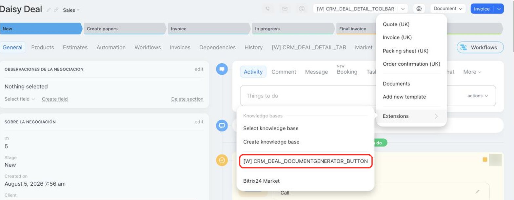

# Dropdown Menu Item for the Document Generator CRM_XXX_DOCUMENTGENERATOR_BUTTON



Choose a tool for developing with an AI agent:

- use [Alaio Vibecode](../../../ai-tools/vibecode.md) to build an app for Bitrix24 from a task description without knowing any programming language. The agent writes the code and deploys the app to a server, with no manual hosting setup
- use the [MCP server](../../../ai-tools/mcp.md) to develop a REST API integration in your own project. The agent refers to the official REST documentation



> Scope: [`placement, crm`](../../scopes/permissions.md)

The widget adds its own item to the dropdown menu of the document generator of a CRM object. When a user selects the application item, the widget handler opens.

The placement code is specified in the `PLACEMENT` parameter of the [placement.bind](../placement-bind.md) method.



The widget is not displayed in the interface until the application installation is complete. [Check the application installation](../../../settings/app-installation/installation-finish.md)



## How the Placement Works

1. The application registers a handler with the [placement.bind](../placement-bind.md) method using a code from the [table](#codes). The method works only on behalf of an application; the placement cannot be registered with a webhook. A widget can be registered by an administrator or by an employee with the permission to create applications
2. The application item appears in the *Extensions* submenu of the document generator menu in a CRM entity form
3. The user selects the item, and Bitrix24 opens the handler in a frame with the data described in the [What the Handler Receives](#handler-data) section
4. The handler can call REST on behalf of the current user with the token from `AUTH_ID`: for example, retrieve the object data by `ENTITY_ID`

## When to Use

The placement suits applications that build documents for the object on their own side. For example:

- prepare a printed form based on the deal data
- open an external service to draft a contract or an act

For an action in the top menu of the form, use [CRM_XXX_DETAIL_TOOLBAR](./detail-toolbar.md); for a separate tab with the application interface, use [CRM_XXX_DETAIL_TAB](./detail-tab.md).

## Where the Widget Is Embedded {#codes}

#|
|| **Placement Code** | **Location** ||
|| `CRM_LEAD_DOCUMENTGENERATOR_BUTTON` | Item in the dropdown menu of the document generator for a [lead](../../crm/leads/index.md) ||
|| `CRM_CONTACT_DOCUMENTGENERATOR_BUTTON` | Item in the dropdown menu of the document generator for a [contact](../../crm/contacts/index.md) ||
|| `CRM_COMPANY_DOCUMENTGENERATOR_BUTTON` | Item in the dropdown menu of the document generator for a [company](../../crm/companies/index.md) ||
|| `CRM_DEAL_DOCUMENTGENERATOR_BUTTON` | Item in the dropdown menu of the document generator for a [deal](../../crm/deals/index.md) ||
|| `CRM_SMART_INVOICE_DOCUMENTGENERATOR_BUTTON` | Item in the dropdown menu of the document generator for a [new invoice](../../crm/universal/invoice.md) ||
|| `CRM_QUOTE_DOCUMENTGENERATOR_BUTTON` | Item in the dropdown menu of the document generator for an [estimate](../../crm/quote/index.md) ||
|| `CRM_DYNAMIC_XXX_DOCUMENTGENERATOR_BUTTON` | Item in the dropdown menu of the document generator for a custom CRM object type. Instead of XXX, specify the numeric identifier of the specific [custom object type](../../crm/universal/index.md). For example, `CRM_DYNAMIC_183_DOCUMENTGENERATOR_BUTTON` ||
|#

### Where to Find It in the Interface

Open a CRM entity form, click the *Document* or *Documents* button at the top of the form, and hover over the *Extensions* item. The application item appears in this submenu.

The button is available if the document generator is enabled and the user has permission to view documents or edit templates. In the form of a custom object type item or a new invoice, the item must also be saved, and document generation must be enabled for the object type.



## What the Handler Receives {#handler-data}

Data is sent in a POST request: some parameters come in the handler URL query string, the rest in the request body {.b24-info}

The example is shown for the `CRM_DEAL_DOCUMENTGENERATOR_BUTTON` placement.

```php

Array
(
    [DOMAIN] => xxx.bitrix24.com
    [PROTOCOL] => 1
    [LANG] => en
    [APP_SID] => 23ab3058338edf7c4c30a52e4d0b3f94
    [AUTH_ID] => 83fd7166007e9c94001e30ba00000001f0f107a52e6ad7ef9a1b8c3d5e2f4061
    [AUTH_EXPIRES] => 3600
    [REFRESH_ID] => 737c9966007e9c94001e30ba00000001f0f1072b8d4e6f01a3c57d9e8b2f4160
    [SERVER_ENDPOINT] => https://oauth.bitrix.info/rest/
    [APPLICATION_TOKEN] => ec1b2074a9d3f5c81b6e40d27a95cf38
    [APPLICATION_SCOPE] => crm,documentgenerator,placement
    [member_id] => d897063e1ce7c5eb9f04b9751eef5915
    [status] => L
    [PLACEMENT] => CRM_DEAL_DOCUMENTGENERATOR_BUTTON
    [PLACEMENT_OPTIONS] => {"ENTITY_ID":"5","URI":"\/crm\/deal\/details\/5\/?any=details%2F5%2F"}
)

```

`APPLICATION_SCOPE` contains the scopes of the example application. Registering the placement itself requires only `placement` and `crm`.





### PLACEMENT_OPTIONS

The placement's own key is `ENTITY_ID`.



#|
|| **Parameter** | **Description** ||
|| **ENTITY_ID***
[`string`](../../data-types.md) | The identifier of the CRM object for which the widget was opened.

Use the identifier to retrieve the object data with the corresponding CRM method. [crm.item.get](../../crm/universal/crm-item-get.md) also requires the [object type identifier](../../crm/data-types.md#object_type).

The object type identifier does not arrive as a separate key. For a custom object type it can be taken from the value of the `PLACEMENT` parameter: for the `CRM_DYNAMIC_183_DOCUMENTGENERATOR_BUTTON` code, the type identifier is `183`

||
|#

## OPTIONS when registering via placement.bind

The placement does not support the `OPTIONS` parameters. Passed values are not saved: the [placement.get](../placement-get.md) method returns an empty array for such a registration.

## Code Examples





- cURL (OAuth)

    ```bash
    curl -X POST \
      -H "Content-Type: application/json" \
      -H "Accept: application/json" \
      -d '{
        "PLACEMENT": "CRM_DEAL_DOCUMENTGENERATOR_BUTTON",
        "HANDLER": "https://your-domain.com/widgets/crm-document-handler.php",
        "TITLE": "Supply contract",
        "LANG_ALL": {
          "en": {
            "TITLE": "Supply contract"
          },
          "de": {
            "TITLE": "Liefervertrag"
          }
        },
        "auth": "**put_access_token_here**"
      }' \
      https://**put_your_bitrix24_address**/rest/placement.bind
    ```

- JS (TS)

    ```ts
    // This snippet is an ES module: top-level await requires type="module" or a bundler.
    // $b24 is an already-initialized SDK instance (see the SDK "Get started" guide).
    import { Text } from '@bitrix24/b24jssdk'
    import type { B24Frame } from '@bitrix24/b24jssdk'

    declare const $b24: B24Frame

    try {
      const response = await $b24.actions.v2.call.make<boolean>({
        method: 'placement.bind',
        params: {
          PLACEMENT: 'CRM_DEAL_DOCUMENTGENERATOR_BUTTON',
          HANDLER: 'https://your-domain.com/widgets/crm-document-handler.php',
          TITLE: 'Supply contract',
          LANG_ALL: {
            en: {
              TITLE: 'Supply contract',
            },
            de: {
              TITLE: 'Liefervertrag',
            },
          },
        },
        requestId: Text.getUuidRfc4122()
      })

      // The payload is available only on a successful response
      if (!response.isSuccess) {
        console.error(response.getErrorMessages().join('; '))
      } else {
        const result = response.getData()!.result
        console.info('Placement bound successfully:', result)
      }
    } catch (error) {
      // Thrown on transport or SDK failures (AjaxError, SdkError, etc.)
      console.error(error)
    }
    ```

- JS (UMD)

    ```html
    <!-- Load the SDK (UMD build); it is exposed as the global B24Js -->
    <script src="https://unpkg.com/@bitrix24/b24jssdk@1/dist/umd/index.min.js"></script>
    <script>
      async function bindCrmDocumentGeneratorButton() {
        try {
          // Initialize the SDK inside a Bitrix24 frame
          const $b24 = await B24Js.initializeB24Frame()

          const response = await $b24.actions.v2.call.make({
            method: 'placement.bind',
            params: {
              PLACEMENT: 'CRM_DEAL_DOCUMENTGENERATOR_BUTTON',
              HANDLER: 'https://your-domain.com/widgets/crm-document-handler.php',
              TITLE: 'Supply contract',
              LANG_ALL: {
                en: {
                  TITLE: 'Supply contract',
                },
                de: {
                  TITLE: 'Liefervertrag',
                },
              },
            },
            requestId: B24Js.Text.getUuidRfc4122()
          })

          // The payload is available only on a successful response
          if (!response.isSuccess) {
            console.error(response.getErrorMessages().join('; '))
            return
          }

          const result = response.getData().result
          console.info('Placement bound successfully:', result)
        } catch (error) {
          // Thrown on transport or SDK failures (AjaxError, SdkError, etc.)
          console.error(error)
        }
      }

      document.addEventListener('DOMContentLoaded', bindCrmDocumentGeneratorButton)
    </script>
    ```

- PHP

    ```php
    try {
        $response = $b24Service
            ->core
            ->call(
                'placement.bind',
                [
                    'PLACEMENT' => 'CRM_DEAL_DOCUMENTGENERATOR_BUTTON',
                    'HANDLER' => 'https://your-domain.com/widgets/crm-document-handler.php',
                    'TITLE' => 'Supply contract',
                    'LANG_ALL' => [
                        'en' => [
                            'TITLE' => 'Supply contract',
                        ],
                        'de' => [
                            'TITLE' => 'Liefervertrag',
                        ],
                    ],
                ]
            );

        $result = $response->getResponseData()->getResult();

        print_r($result);
    } catch (Throwable $e) {
        echo $e->getMessage();
    }
    ```

- BX24.js

    ```js
    BX24.callMethod(
        'placement.bind',
        {
            PLACEMENT: 'CRM_DEAL_DOCUMENTGENERATOR_BUTTON',
            HANDLER: 'https://your-domain.com/widgets/crm-document-handler.php',
            TITLE: 'Supply contract',
            LANG_ALL: {
                en: { TITLE: 'Supply contract' },
                de: { TITLE: 'Liefervertrag' }
            }
        },
        function(result) {
            if (result.error()) {
                console.error(result.error());
            } else {
                console.log(result.data());
            }
        }
    );
    ```

- PHP CRest

    ```php
    require_once('crest.php');

    $result = CRest::call(
        'placement.bind',
        [
            'PLACEMENT' => 'CRM_DEAL_DOCUMENTGENERATOR_BUTTON',
            'HANDLER' => 'https://your-domain.com/widgets/crm-document-handler.php',
            'TITLE' => 'Supply contract',
            'LANG_ALL' => [
                'en' => [
                    'TITLE' => 'Supply contract',
                ],
                'de' => [
                    'TITLE' => 'Liefervertrag',
                ],
            ],
        ]
    );

    echo '<PRE>';
    print_r($result);
    echo '</PRE>';
    ```

- Go

    ```go
    // client and ctx are already created — see the Go SDK section
    res, err := client.Core().Call(ctx, "placement.bind", b24.Params{
    	"PLACEMENT": "CRM_DEAL_DOCUMENTGENERATOR_BUTTON",
    	"HANDLER":   "https://your-domain.com/widgets/crm-document-handler.php",
    	"TITLE":     "Supply contract",
    	"LANG_ALL": b24.Params{
    		"en": b24.Params{
    			"TITLE": "Supply contract",
    		},
    		"de": b24.Params{
    			"TITLE": "Liefervertrag",
    		},
    	},
    })
    if err != nil {
    	return fmt.Errorf("placement.bind: %w", err)
    }

    // The response arrives as json.RawMessage — unmarshal it into the response
    // shape of the placement.bind method, see "Response Handling" on its page.
    fmt.Printf("%s\n", res.Result)
    ```



## Common Mistakes

#|
|| **Mistake** | **Solution** ||
|| `placement.bind` returns `WRONG_AUTH_TYPE` with the description `Application context required` | Register the placement on behalf of an application. A placement cannot be bound with a webhook ||
|| `placement.bind` returns `ERROR_PLACEMENT_NOT_FOUND` | The code is assembled for an object type that this placement does not support, or the application has not been granted the `crm` scope. Check the code against the table at the beginning of the page ||
|| The widget is registered but does not appear in the interface | Complete the [application installation](../../../settings/app-installation/installation-finish.md) and reload the page ||
|| The item is not visible in the document generator menu | Hover over the *Extensions* item: the application item is displayed in this submenu ||
|#

Other registration error codes are listed in the "Possible Error Codes" section of the [placement.bind](../placement-bind.md) page.

## Continue Learning

- [{#T}](./index.md)
- [{#T}](./detail-toolbar.md)
- [{#T}](../placement-bind.md)
- [{#T}](../ui-interaction/index.md)
- [{#T}](../bx24-widget-methods.md)
- [{#T}](../../../settings/interactivity/index.md)
