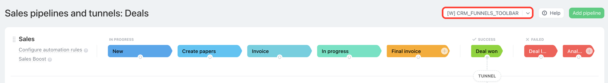

# Button in Sales Pipelines and Tunnels CRM_FUNNELS_TOOLBAR, CRM_DYNAMIC_XXX_FUNNELS_TOOLBAR



Choose a tool for developing with an AI agent:

- use [Alaio Vibecode](../../../ai-tools/vibecode.md) to build an app for Bitrix24 from a task description without knowing any programming language. The agent writes the code and deploys the app to a server, with no manual hosting setup
- use the [MCP server](../../../ai-tools/mcp.md) to develop a REST API integration in your own project. The agent refers to the official REST documentation



> Scope: [`placement, crm`](../../scopes/permissions.md)

The widget adds an item to the split button menu in the settings window for sales pipelines and tunnels of [deals](../../crm/deals/index.md) and [custom object types](../../crm/universal/index.md).

The placement code is specified in the `PLACEMENT` parameter of the [placement.bind](../placement-bind.md) method.



The widget is not displayed in the interface until the application installation is complete. [Check the application installation](../../../settings/app-installation/installation-finish.md)



## How the Placement Works

1. The application registers a handler with the [placement.bind](../placement-bind.md) method: it passes a code from the [table](#codes) in `PLACEMENT` and the handler URL in `HANDLER`. The method works only on behalf of an application; the placement cannot be registered with a webhook. A widget can be registered by an administrator or by an employee with the permission to create applications
2. An item with the name from `TITLE` appears in the split button menu in the header of the sales pipelines and tunnels window. If no name is set, the application name is used. Items with the same `GROUP_NAME` are combined into a submenu
3. When a user selects the item, Bitrix24 opens the handler in a frame. The handler receives a POST request with the [call data](#handler-data)
4. The handler can call REST on behalf of the current user with the token from `AUTH_ID`. The CRM object type is determined by the code in `PLACEMENT`: `CRM_FUNNELS_TOOLBAR` means deals, `CRM_DYNAMIC_183_FUNNELS_TOOLBAR` means the custom type with `entityTypeId` 183. The pipeline identifier is not passed to the handler; the pipelines of a type can be retrieved with the [crm.category.list](../../crm/universal/category/crm-category-list.md) method

## When to Use

The placement suits cases when you need to:

- open the integration settings from the pipelines and tunnels window
- show an application report on pipelines

For actions from the object list, use [CRM_XXX_LIST_TOOLBAR](./list-toolbar.md), and from the automation rules designer — [CRM_XXX_ROBOT_DESIGNER_TOOLBAR](./robot-designer-toolbar.md).

## Where the Widget Is Embedded {#codes}

#| 
|| **Placement Code** | **Location** ||
|| `CRM_FUNNELS_TOOLBAR` | Split button menu item in the pipelines and tunnels of [deals](../../crm/deals/index.md) ||
|| `CRM_DYNAMIC_XXX_FUNNELS_TOOLBAR` | Split button menu item in the pipelines and tunnels of a custom CRM object type. Replace XXX with the numeric identifier of the specific [custom object type](../../crm/universal/index.md). For example, `CRM_DYNAMIC_183_FUNNELS_TOOLBAR` ||
|#

### Where to Find It in the Interface

Open the kanban of CRM objects, expand the pipeline list, and select *Sales tunnels*. A split button appears on the right in the window header: click the arrow on it and select the application item. The button itself shows the item the user selects most often, or the *Extensions* label. The screenshot below shows what the button looks like.

To open the window, the user needs at least one of these permissions: manage pipelines, stages, or tunnels of the corresponding CRM type. For a custom object type, the window opens only if pipelines are enabled in the type settings.



## What the Handler Receives {#handler-data}

Data is sent in a POST request: some parameters come in the handler URL query string, the rest in the request body {.b24-info}

The example is shown for the `CRM_FUNNELS_TOOLBAR` placement. For the other codes, the data set is the same: only the `PLACEMENT` value and the path in `URI` change.

```php

Array
(
    [DOMAIN] => xxx.bitrix24.com
    [PROTOCOL] => 1
    [LANG] => en
    [APP_SID] => 4048ea3ba712b0c1db2a6cc2b0e61183
    [AUTH_ID] => d4917166007e9c94001e30ba00000001f0f1078f2c1d40e95b73a6cd50218e4
    [AUTH_EXPIRES] => 3600
    [REFRESH_ID] => c3809966007e9c94001e30ba00000001f0f1078bd5e26f307ac194fb2e63d05
    [SERVER_ENDPOINT] => https://oauth.bitrix.info/rest/
    [APPLICATION_TOKEN] => ec1b2074a9d3f5c81b6e40d27a95cf38
    [APPLICATION_SCOPE] => crm,placement
    [member_id] => d897063e1ce7c5eb9f04b9751eef5915
    [status] => L
    [PLACEMENT] => CRM_FUNNELS_TOOLBAR
    [PLACEMENT_OPTIONS] => {"URI":"\/crm\/deal\/kanban\/"}
)

```





### PLACEMENT_OPTIONS

The placement has no keys of its own. The common `URI` key is described in the standard data above.

## OPTIONS When Registering via placement.bind

This placement does not support the `OPTIONS` parameters. The values passed are not retained: the [placement.get](../placement-get.md) method returns an empty array for such a registration.

## Code Examples





- cURL (OAuth)

    ```bash
    curl -X POST \
      -H "Content-Type: application/json" \
      -H "Accept: application/json" \
      -d '{
        "PLACEMENT": "CRM_FUNNELS_TOOLBAR",
        "HANDLER": "https://your-domain.com/widgets/crm-funnels-toolbar-handler.php",
        "TITLE": "My sales tunnels item",
        "LANG_ALL": {
          "en": {
            "TITLE": "My sales tunnels item"
          },
          "de": {
            "TITLE": "Mein Vertriebstunnel-Menüpunkt"
          }
        },
        "auth": "**put_access_token_here**"
      }' \
      https://**put_your_bitrix24_address**/rest/placement.bind
    ```

- JS (TS)

    ```ts
    // This snippet is an ES module: top-level await requires type="module" or a bundler.
    // $b24 is an already-initialized SDK instance (see the SDK "Get started" guide).
    import { Text } from '@bitrix24/b24jssdk'
    import type { B24Frame } from '@bitrix24/b24jssdk'

    declare const $b24: B24Frame

    try {
      const response = await $b24.actions.v2.call.make<boolean>({
        method: 'placement.bind',
        params: {
          PLACEMENT: 'CRM_FUNNELS_TOOLBAR',
          HANDLER: 'https://your-domain.com/widgets/crm-funnels-toolbar-handler.php',
          TITLE: 'My sales tunnels item',
          LANG_ALL: {
            en: {
              TITLE: 'My sales tunnels item',
            },
            de: {
              TITLE: 'Mein Vertriebstunnel-Menüpunkt',
            },
          },
        },
        requestId: Text.getUuidRfc4122()
      })

      // The payload is available only on a successful response
      if (!response.isSuccess) {
        console.error(response.getErrorMessages().join('; '))
      } else {
        const result = response.getData()!.result
        console.info('Placement bound successfully:', result)
      }
    } catch (error) {
      // Thrown on transport or SDK failures (AjaxError, SdkError, etc.)
      console.error(error)
    }
    ```

- JS (UMD)

    ```html
    <!-- Load the SDK (UMD build); it is exposed as the global B24Js -->
    <script src="https://unpkg.com/@bitrix24/b24jssdk@1/dist/umd/index.min.js"></script>
    <script>
      async function bindCrmFunnelsToolbar() {
        try {
          // Initialize the SDK inside a Bitrix24 frame
          const $b24 = await B24Js.initializeB24Frame()

          const response = await $b24.actions.v2.call.make({
            method: 'placement.bind',
            params: {
              PLACEMENT: 'CRM_FUNNELS_TOOLBAR',
              HANDLER: 'https://your-domain.com/widgets/crm-funnels-toolbar-handler.php',
              TITLE: 'My sales tunnels item',
              LANG_ALL: {
                en: {
                  TITLE: 'My sales tunnels item',
                },
                de: {
                  TITLE: 'Mein Vertriebstunnel-Menüpunkt',
                },
              },
            },
            requestId: B24Js.Text.getUuidRfc4122()
          })

          // The payload is available only on a successful response
          if (!response.isSuccess) {
            console.error(response.getErrorMessages().join('; '))
            return
          }

          const result = response.getData().result
          console.info('Placement bound successfully:', result)
        } catch (error) {
          // Thrown on transport or SDK failures (AjaxError, SdkError, etc.)
          console.error(error)
        }
      }

      document.addEventListener('DOMContentLoaded', bindCrmFunnelsToolbar)
    </script>
    ```

- PHP

    ```php
    try {
        $response = $b24Service
            ->core
            ->call(
                'placement.bind',
                [
                    'PLACEMENT' => 'CRM_FUNNELS_TOOLBAR',
                    'HANDLER' => 'https://your-domain.com/widgets/crm-funnels-toolbar-handler.php',
                    'TITLE' => 'My sales tunnels item',
                    'LANG_ALL' => [
                        'en' => [
                            'TITLE' => 'My sales tunnels item',
                        ],
                        'de' => [
                            'TITLE' => 'Mein Vertriebstunnel-Menüpunkt',
                        ],
                    ],
                ]
            );

        $result = $response->getResponseData()->getResult();

        print_r($result);
    } catch (Throwable $e) {
        echo $e->getMessage();
    }
    ```

- BX24.js

    ```js
    BX24.callMethod(
        'placement.bind',
        {
            PLACEMENT: 'CRM_FUNNELS_TOOLBAR',
            HANDLER: 'https://your-domain.com/widgets/crm-funnels-toolbar-handler.php',
            TITLE: 'My sales tunnels item',
            LANG_ALL: {
                en: { TITLE: 'My sales tunnels item' },
                de: { TITLE: 'Mein Vertriebstunnel-Menüpunkt' }
            }
        },
        function(result) {
            if (result.error()) {
                console.error(result.error());
            } else {
                console.log(result.data());
            }
        }
    );
    ```

- PHP CRest

    ```php
    require_once('crest.php');

    $result = CRest::call(
        'placement.bind',
        [
            'PLACEMENT' => 'CRM_FUNNELS_TOOLBAR',
            'HANDLER' => 'https://your-domain.com/widgets/crm-funnels-toolbar-handler.php',
            'TITLE' => 'My sales tunnels item',
            'LANG_ALL' => [
                'en' => [
                    'TITLE' => 'My sales tunnels item',
                ],
                'de' => [
                    'TITLE' => 'Mein Vertriebstunnel-Menüpunkt',
                ],
            ],
        ]
    );

    echo '<PRE>';
    print_r($result);
    echo '</PRE>';
    ```

- Go

    ```go
    // client and ctx are already created — see the Go SDK section
    res, err := client.Core().Call(ctx, "placement.bind", b24.Params{
    	"PLACEMENT": "CRM_FUNNELS_TOOLBAR",
    	"HANDLER":   "https://your-domain.com/widgets/crm-funnels-toolbar-handler.php",
    	"TITLE":     "My sales tunnels item",
    	"LANG_ALL": b24.Params{
    		"en": b24.Params{
    			"TITLE": "My sales tunnels item",
    		},
    		"de": b24.Params{
    			"TITLE": "Mein Vertriebstunnel-Menüpunkt",
    		},
    	},
    })
    if err != nil {
    	return fmt.Errorf("placement.bind: %w", err)
    }

    // The response arrives as json.RawMessage — unmarshal it into the response
    // shape of the placement.bind method, see "Response Handling" on its page.
    fmt.Printf("%s\n", res.Result)
    ```



## Common Mistakes

#|
|| **Mistake** | **Solution** ||
|| `placement.bind` returns `WRONG_AUTH_TYPE` with the description `Application context required` | Register the placement on behalf of an application. A placement cannot be bound with a webhook ||
|| `placement.bind` returns `ERROR_PLACEMENT_NOT_FOUND` | Check the code against the [placement table](#codes) and make sure the application has been granted the `crm` scope ||
|| `placement.bind` with the `CRM_DEAL_FUNNELS_TOOLBAR` code returns `ERROR_PLACEMENT_NOT_FOUND` | For deals, the placement code carries no object name — use `CRM_FUNNELS_TOOLBAR` ||
|| The widget is registered but does not appear in the interface | Complete the [application installation](../../../settings/app-installation/installation-finish.md) and reload the page ||
|#

Other registration error codes are listed in the "Possible Error Codes" section of the [placement.bind](../placement-bind.md) page.

## Continue Your Exploration

- [{#T}](./index.md)
- [{#T}](./robot-designer-toolbar.md)
- [{#T}](./list-toolbar.md)
- [{#T}](../placement-bind.md)
- [{#T}](../ui-interaction/index.md)
- [{#T}](../../../settings/interactivity/index.md)
- [{#T}](../bx24-widget-methods.md)