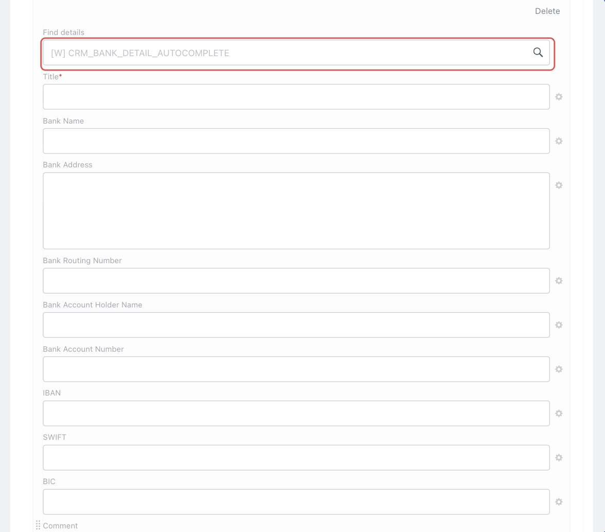

# Bank Details Autofill in the CRM Card CRM_BANK_DETAIL_AUTOCOMPLETE



Choose a tool for developing with an AI agent:

- use [Alaio Vibecode](../../../../ai-tools/vibecode.md) to build an app for Bitrix24 from a task description without knowing any programming language. The agent writes the code and deploys the app to a server, with no manual hosting setup
- use the [MCP server](../../../../ai-tools/mcp.md) to develop a REST API integration in your own project. The agent refers to the official REST documentation



> Scope: [`placement, crm`](../../../scopes/permissions.md)

The `CRM_BANK_DETAIL_AUTOCOMPLETE` point connects an application handler to the bank details search in a CRM card. It is required when an application searches for and populates bank company details, for example, by BIC.

The embedding point code is passed in the `PLACEMENT` parameter of the [placement.bind](../../placement-bind.md) method.



The handler will not be available in the search source selection interface until the application installation is complete. [Check the application installation](../../../../settings/app-installation/installation-finish.md)



## How the Placement Works

1. The application registers the handler with the [placement.bind](../../placement-bind.md) method using the `CRM_BANK_DETAIL_AUTOCOMPLETE` code. The method works only on behalf of an application; the placement cannot be registered with a webhook. The widget can be registered by an administrator or by an employee with the permission to create applications
2. The user opens the [search field](#codes) and enters at least three characters. If several sources are available, the user selects the application source
3. Bitrix24 loads the handler in a hidden frame and passes the search string in `PLACEMENT_OPTIONS`
4. The handler can call REST on behalf of the current user with the token from `AUTH_ID`. The application returns the options with the `crmShowFoundEntities` command, and after an option is selected, it receives the `onCrmEntityIsNeedToCreate` event and passes the fields to fill in with the `crmShowCreatedEntity` command

## When to Use

- find a bank by its BIC in an external directory
- fill in the bank name, correspondent account, and SWIFT from the application data

For the details of the client itself, use [CRM_REQUISITE_AUTOCOMPLETE](./requisite-autocomplete.md).

## Where the Widget Is Embedded {#codes}

#|
|| **Embedding Point Code** | **Location** ||
|| `CRM_BANK_DETAIL_AUTOCOMPLETE` | Search source in the *Find details* field of the *Banking details* section of the details form ||
|#

### Where to Find It in the Interface

To reach the search field:

1. Open a company or contact card
2. In the *Details* field, click the *details* link
3. In the details form, add banking details

The handler is connected to the *Find details* field in the *Banking details* section. Enter at least three characters to start the search.

If only one search source is available, its name is shown as a hint inside the field. If there are several sources, they are offered in a list below the field as you type a query. The application handler appears in this list under the name from the `TITLE` parameter.



## What the Handler Receives {#handler-data}

Data is sent in a POST request: some parameters come in the handler URL query string, the rest in the request body {.b24-info}

```php
Array
(
    [DOMAIN] => xxx.bitrix24.com
    [PROTOCOL] => 1
    [LANG] => en
    [APP_SID] => 8b3f2c5d9c1a4f6e9d7a2b4c6f8e1a3d
    [AUTH_ID] => 1f0f107e5806d5fe9a98e02021a72e57645f86a
    [AUTH_EXPIRES] => 3600
    [REFRESH_ID] => 1f0f107a80816604b24a8719792ac2a21d629b5
    [SERVER_ENDPOINT] => https://oauth.bitrix.info/rest/
    [APPLICATION_TOKEN] => ec1b2074a9d3f5c81b6e40d27a95cf38
    [APPLICATION_SCOPE] => crm,placement
    [member_id] => da45a03b265edd8787f8a258d793cc5d
    [status] => L
    [PLACEMENT] => CRM_BANK_DETAIL_AUTOCOMPLETE
    [PLACEMENT_OPTIONS] => {"searchQuery":"044599999","URI":"\/bitrix\/components\/bitrix\/crm.requisite.details\/slider.ajax.php?requisite_id=n0&sessid=1a2b3c4d5e6f7a8b9c0d1e2f3a4b5c6d&etype=4&eid=2979&external_context_id=COMPANY_2979&pid=1&cid=0&IFRAME=Y&IFRAME_TYPE=SIDE_SLIDER"}
)
```

After parsing, the `PLACEMENT_OPTIONS` string from this example looks like this:

```json
{
    "searchQuery": "044599999",
    "URI": "/bitrix/components/bitrix/crm.requisite.details/slider.ajax.php?requisite_id=n0&sessid=1a2b3c4d5e6f7a8b9c0d1e2f3a4b5c6d&etype=4&eid=2979&external_context_id=COMPANY_2979&pid=1&cid=0&IFRAME=Y&IFRAME_TYPE=SIDE_SLIDER"
}
```

`APPLICATION_SCOPE` lists the scopes of the application from the example. The placement itself is registered in the `crm` scope.



### PLACEMENT_OPTIONS

The value of `PLACEMENT_OPTIONS` is passed as a JSON string.



#|
|| **Parameter** | **Description** ||
|| **searchQuery***
[`string`](../../../data-types.md) | The string that the user entered in the bank details search field ||
|| **URI**
[`string`](../../../data-types.md) | Path and query string of the page the handler is called from. In the example above, `URI` points to the details form, and the `eid` and `external_context_id` parameters contain the client identifier ||
|#

## OPTIONS When Registering via placement.bind

The placement supports the `OPTIONS` parameter of the [placement.bind](../../placement-bind.md) method. It restricts the list of countries the handler works for and is not included in the data that Bitrix24 passes to the handler during a search.

#|
|| **Parameter**
`type` | **Description** ||
|| **countries**
[`string`](../../../data-types.md) | Positive numeric country identifiers without leading zeros, separated by commas without spaces, for example `1,3`. If the parameter is missing or the string does not match this format, no country restriction is applied.

Country identifiers can be obtained via the [crm.requisite.preset.countries](../../../crm/requisites/presets/crm-requisite-preset-countries.md) ||
|#

## How to Return Found Options

Pass the found options using the [BX24.placement.call](../../ui-interaction/bx24-placement-call.md) command with the name `crmShowFoundEntities`.

Pass the result within 20 seconds after the hidden handler frame is created. If the response does not arrive in time, the search source reports an error.

#|
|| **Field**
`type` | **Description** ||
|| **data**
[`array`](../../../data-types.md) | List of found options ||
|| **data[].id**
[`string`](../../../data-types.md) | Option identifier on the application side ||
|| **data[].name**
[`string`](../../../data-types.md) | Option name that will be shown to the user ||
|| **data[].phone**
[`string`](../../../data-types.md) | Option phone. Pass the field if the number is found ||
|| **data[].email**
[`string`](../../../data-types.md) | Option E-mail. Pass the field if the address is found ||
|| **data[].web**
[`string`](../../../data-types.md) | Option website. Pass the field if the website is found ||
|#

```javascript
BX24.placement.call(
    'crmShowFoundEntities',
    {
        data: [
            {
                id: 'bank-123456789',
                name: 'Ltd. Superbank',
                phone: '+49 30 000-00-00',
                web: 'https://bank.example.com'
            }
        ]
    }
);
```

## How to Fill the Selected Option Into the Card

If a user selects an option from the application response, Bitrix24 triggers the `onCrmEntityIsNeedToCreate` interface event. Subscribe to it using the [BX24.placement.bindEvent](../../ui-interaction/bx24-placement-bind-event.md) method.

The data of the selected option is passed to the `onCrmEntityIsNeedToCreate` event handler.

#|
|| **Field**
`type` | **Description** ||
|| **appSid**
[`string`](../../../data-types.md) | Application session identifier in which the selected option was found ||
|| **data**
[`object`](../../../data-types.md) | The selected option: `id` is the identifier from the application response, `title` is the `name` value, `attributes` contains the contact data. The object also contains service fields of the interface ||
|#

Retrieve the bank data by `selected.id` from your source and pass the corresponding values in `fields`. The values below apply only to the demo option `bank-123456789`.

```javascript
BX24.placement.bindEvent('onCrmEntityIsNeedToCreate', function (eventData) {
    const selected = eventData.data;
    const selectedTitle = selected.title;

    BX24.placement.call(
        'crmShowCreatedEntity',
        {
            entityType: 'bank',
            id: selected.id,
            title: selectedTitle,
            fields: {
                NAME: selectedTitle,
                RQ_BANK_NAME: selectedTitle,
                RQ_BIK: '123456789',
                RQ_BANK_ADDR: 'Berlin',
                RQ_COR_ACC_NUM: '1234567890',
                RQ_SWIFT: 'EXAMPLEDE'
            }
        }
    );
});
```

Fields of the `crmShowCreatedEntity` command:

#|
|| **Field**
`type` | **Description** ||
|| **entityType**
[`string`](../../../data-types.md) | Type of the option on the application side, for example `bank` ||
|| **id**
[`string`](../../../data-types.md) | Identifier of the selected option on the application side ||
|| **title**
[`string`](../../../data-types.md) | Name of the selected option ||
|| **fields**
[`object`](../../../data-types.md) | Bank details fields that need to be filled into the CRM card ||
|#

The available bank details fields are described in the [Banking Details](../../../crm/requisites/bank-detail/index.md) section.

## Code Examples





- cURL (OAuth)

    ```bash
    curl -X POST \
      -H "Content-Type: application/json" \
      -H "Accept: application/json" \
      -d '{
        "PLACEMENT": "CRM_BANK_DETAIL_AUTOCOMPLETE",
        "HANDLER": "https://your-domain.com/widgets/crm-bank-detail-autocomplete-handler.php",
        "TITLE": "Bank detail search",
        "LANG_ALL": {
          "de": {
            "TITLE": "Bank detail search"
          },
          "en": {
            "TITLE": "Bank detail search"
          }
        },
        "OPTIONS": {
          "countries": "1"
        },
        "auth": "**put_access_token_here**"
      }' \
      https://**put_your_bitrix24_address**/rest/placement.bind
    ```

- JS (TS)

    ```ts
    // This snippet is an ES module: top-level await requires type="module" or a bundler.
    // $b24 is an already-initialized SDK instance (see the SDK "Get started" guide).
    import { Text } from '@bitrix24/b24jssdk'
    import type { B24Frame } from '@bitrix24/b24jssdk'

    declare const $b24: B24Frame

    try {
      const response = await $b24.actions.v2.call.make<boolean>({
        method: 'placement.bind',
        params: {
          PLACEMENT: 'CRM_BANK_DETAIL_AUTOCOMPLETE',
          HANDLER: 'https://your-domain.com/widgets/crm-bank-detail-autocomplete-handler.php',
          TITLE: 'Bank detail search',
          LANG_ALL: {
            de: {
              TITLE: 'Bank detail search',
            },
            en: {
              TITLE: 'Bank detail search',
            },
          },
          OPTIONS: {
            countries: '1',
          },
        },
        requestId: Text.getUuidRfc4122()
      })

      // The payload is available only on a successful response
      if (!response.isSuccess) {
        console.error(response.getErrorMessages().join('; '))
      } else {
        const result = response.getData()!.result
        console.info('Placement bound successfully:', result)
      }
    } catch (error) {
      // Thrown on transport or SDK failures (AjaxError, SdkError, etc.)
      console.error(error)
    }
    ```

- JS (UMD)

    ```html
    <!-- Load the SDK (UMD build); it is exposed as the global B24Js -->
    <script src="https://unpkg.com/@bitrix24/b24jssdk@1/dist/umd/index.min.js"></script>
    <script>
      async function bindCrmBankDetailAutocomplete() {
        try {
          // Initialize the SDK inside a Bitrix24 frame
          const $b24 = await B24Js.initializeB24Frame()

          const response = await $b24.actions.v2.call.make({
            method: 'placement.bind',
            params: {
              PLACEMENT: 'CRM_BANK_DETAIL_AUTOCOMPLETE',
              HANDLER: 'https://your-domain.com/widgets/crm-bank-detail-autocomplete-handler.php',
              TITLE: 'Bank detail search',
              LANG_ALL: {
                de: {
                  TITLE: 'Bank detail search',
                },
                en: {
                  TITLE: 'Bank detail search',
                },
              },
              OPTIONS: {
                countries: '1',
              },
            },
            requestId: B24Js.Text.getUuidRfc4122()
          })

          // The payload is available only on a successful response
          if (!response.isSuccess) {
            console.error(response.getErrorMessages().join('; '))
            return
          }

          const result = response.getData().result
          console.info('Placement bound successfully:', result)
        } catch (error) {
          // Thrown on transport or SDK failures (AjaxError, SdkError, etc.)
          console.error(error)
        }
      }

      document.addEventListener('DOMContentLoaded', bindCrmBankDetailAutocomplete)
    </script>
    ```

- PHP

    ```php
    try {
        $response = $b24Service
            ->core
            ->call(
                'placement.bind',
                [
                    'PLACEMENT' => 'CRM_BANK_DETAIL_AUTOCOMPLETE',
                    'HANDLER' => 'https://your-domain.com/widgets/crm-bank-detail-autocomplete-handler.php',
                    'TITLE' => 'Bank detail search',
                    'LANG_ALL' => [
                        'de' => [
                            'TITLE' => 'Bank detail search',
                        ],
                        'en' => [
                            'TITLE' => 'Bank detail search',
                        ],
                    ],
                    'OPTIONS' => [
                        'countries' => '1',
                    ],
                ]
            );

        $result = $response->getResponseData()->getResult();

        print_r($result);
    } catch (Throwable $e) {
        echo $e->getMessage();
    }
    ```

- BX24.js

    ```js
    BX24.callMethod(
        'placement.bind',
        {
            PLACEMENT: 'CRM_BANK_DETAIL_AUTOCOMPLETE',
            HANDLER: 'https://your-domain.com/widgets/crm-bank-detail-autocomplete-handler.php',
            TITLE: 'Bank detail search',
            LANG_ALL: {
                de: { TITLE: 'Bank detail search' },
                en: { TITLE: 'Bank detail search' }
            },
            OPTIONS: {
                countries: '1'
            }
        },
        function(result) {
            if (result.error()) {
                console.error(result.error());
            } else {
                console.log(result.data());
            }
        }
    );
    ```

- PHP CRest

    ```php
    require_once('crest.php');

    $result = CRest::call(
        'placement.bind',
        [
            'PLACEMENT' => 'CRM_BANK_DETAIL_AUTOCOMPLETE',
            'HANDLER' => 'https://your-domain.com/widgets/crm-bank-detail-autocomplete-handler.php',
            'TITLE' => 'Bank detail search',
            'LANG_ALL' => [
                'de' => [
                    'TITLE' => 'Bank detail search',
                ],
                'en' => [
                    'TITLE' => 'Bank detail search',
                ],
            ],
            'OPTIONS' => [
                'countries' => '1',
            ],
        ]
    );

    echo '<PRE>';
    print_r($result);
    echo '</PRE>';
    ```

- Go

    ```go
    // client and ctx are already created — see the Go SDK section
    res, err := client.Core().Call(ctx, "placement.bind", b24.Params{
    	"PLACEMENT": "CRM_BANK_DETAIL_AUTOCOMPLETE",
    	"HANDLER":   "https://your-domain.com/widgets/crm-bank-detail-autocomplete-handler.php",
    	"TITLE":     "Bank detail search",
    	"LANG_ALL": b24.Params{
    		"de": b24.Params{
    			"TITLE": "Bank detail search",
    		},
    		"en": b24.Params{
    			"TITLE": "Bank detail search",
    		},
    	},
    	"OPTIONS": b24.Params{
    		"countries": "1",
    	},
    })
    if err != nil {
    	return fmt.Errorf("placement.bind: %w", err)
    }

    // The response arrives as json.RawMessage — unmarshal it into the response
    // shape of the placement.bind method, see "Response Handling" on its page.
    fmt.Printf("%s\n", res.Result)
    ```



## Common Mistakes

#|
|| **Mistake** | **Solution** ||
|| `placement.bind` returns `WRONG_AUTH_TYPE` with the description `Application context required` | Register the placement on behalf of an application. A placement cannot be bound with a webhook ||
|| The handler is registered but does not appear in the list of search sources | Complete the [application installation](../../../../settings/app-installation/installation-finish.md) and check that the `CRM_BANK_DETAIL_AUTOCOMPLETE` code is passed in `PLACEMENT` ||
|| The handler is unavailable for the required country | Check the value of `OPTIONS[countries]`. The string must contain country identifiers separated by commas without spaces ||
|| Found options are not displayed | Pass the array of options to the `data` field of the `crmShowFoundEntities` command ||
|| The option is not filled into the card after selection | Subscribe to `onCrmEntityIsNeedToCreate` and pass the bank details fields with the `crmShowCreatedEntity` command ||
|#

Other registration error codes are listed in the "Possible Error Codes" section of the [placement.bind](../../placement-bind.md) page.

## Continue Learning

- [{#T}](./index.md)
- [{#T}](./requisite-autocomplete.md)
- [{#T}](../../placement-bind.md)
- [{#T}](../../ui-interaction/index.md)
- [{#T}](../../bx24-widget-methods.md)
- [{#T}](../../../crm/requisites/bank-detail/index.md)
