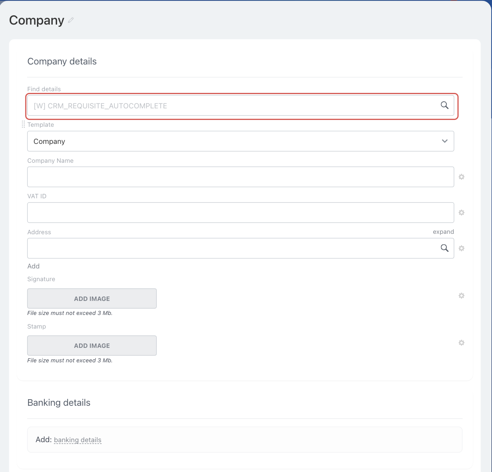

# Client Details Autofill in the CRM Card CRM_REQUISITE_AUTOCOMPLETE



Choose a tool for developing with an AI agent:

- use [Alaio Vibecode](../../../../ai-tools/vibecode.md) to build an app for Bitrix24 from a task description without knowing any programming language. The agent writes the code and deploys the app to a server, with no manual hosting setup
- use the [MCP server](../../../../ai-tools/mcp.md) to develop a REST API integration in your own project. The agent refers to the official REST documentation



> Scope: [`placement, crm`](../../../scopes/permissions.md)

The `CRM_REQUISITE_AUTOCOMPLETE` point connects an application handler to the search for client details in a CRM card. It is required when an application searches for and populates Company details for a company or contact from an external source.

The embedding point code is passed in the `PLACEMENT` parameter of the [placement.bind](../../placement-bind.md) method.



The handler will not be available in the search source selection interface until the application installation is complete. [Check the application installation](../../../../settings/app-installation/installation-finish.md)



## How the Placement Works

1. The application registers the handler with the [placement.bind](../../placement-bind.md) method using the `CRM_REQUISITE_AUTOCOMPLETE` code. The method works only on behalf of an application; the placement cannot be registered with a webhook. The widget can be registered by an administrator or by an employee with the permission to create applications
2. The user opens the [search field](#codes) and enters at least three characters. If several sources are available, the user selects the application source
3. Bitrix24 loads the handler in a hidden frame and passes the search string in `PLACEMENT_OPTIONS`
4. The handler can call REST on behalf of the current user with the token from `AUTH_ID`. The application returns the options with the `crmShowFoundEntities` command, and after an option is selected, it receives the `onCrmEntityIsNeedToCreate` event and passes the fields to fill in with the `crmShowCreatedEntity` command

## When to Use

- find a company by its tax ID in an external directory
- fill in client details from an accounting system

To search for a bank in the details form, use [CRM_BANK_DETAIL_AUTOCOMPLETE](./bank-detail-autocomplete.md).

## Where the Widget Is Embedded {#codes}

#|
|| **Embedding Point Code** | **Location** ||
|| `CRM_REQUISITE_AUTOCOMPLETE` | Search source in the *Details* field of a company or contact card ||
|#

### Where to Find It in the Interface

Open a company or contact card and go to the *Details* field. The handler is connected to the search in this field. Enter at least three characters to start the search.

If only one search source is available, its name is shown as a hint inside the field. If there are several sources, they are offered in a list below the field as you type a query. The application handler appears in this list under the name for the current language from `LANG_ALL`; if `LANG_ALL` is not filled in, `TITLE` is used.



## What the Handler Receives {#handler-data}

Data is sent in a POST request: some parameters come in the handler URL query string, the rest in the request body {.b24-info}

```php
Array
(
    [DOMAIN] => xxx.bitrix24.com
    [PROTOCOL] => 1
    [LANG] => en
    [APP_SID] => 8b3f2c5d9c1a4f6e9d7a2b4c6f8e1a3d
    [AUTH_ID] => 1f0f107e5806d5fe9a98e02021a72e57645f86a
    [AUTH_EXPIRES] => 3600
    [REFRESH_ID] => 1f0f107a80816604b24a8719792ac2a21d629b5
    [SERVER_ENDPOINT] => https://oauth.bitrix.info/rest/
    [APPLICATION_TOKEN] => ec1b2074a9d3f5c81b6e40d27a95cf38
    [APPLICATION_SCOPE] => crm,placement
    [member_id] => da45a03b265edd8787f8a258d793cc5d
    [status] => L
    [PLACEMENT] => CRM_REQUISITE_AUTOCOMPLETE
    [PLACEMENT_OPTIONS] => {"searchQuery":"Daisy","URI":"\/crm\/company\/details\/7\/?any=details%2F7%2F&IFRAME=Y&IFRAME_TYPE=SIDE_SLIDER"}
)
```

After parsing, the `PLACEMENT_OPTIONS` string from this example looks like this:

```json
{
    "searchQuery": "Daisy",
    "URI": "/crm/company/details/7/?any=details%2F7%2F&IFRAME=Y&IFRAME_TYPE=SIDE_SLIDER"
}
```

`APPLICATION_SCOPE` lists the scopes of the application from the example. The placement itself is registered in the `crm` scope.



### PLACEMENT_OPTIONS

The value of `PLACEMENT_OPTIONS` is passed as a JSON string.



#|
|| **Parameter** | **Description** ||
|| **searchQuery***
[`string`](../../../data-types.md) | The string that the user entered in the details search field ||
|#

## OPTIONS When Registering via placement.bind

The placement supports the `OPTIONS` parameter of the [placement.bind](../../placement-bind.md) method. It restricts the list of countries the handler works for and is not included in the data that Bitrix24 passes to the handler during a search.

#|
|| **Parameter**
`type` | **Description** ||
|| **countries**
[`string`](../../../data-types.md) | Positive numeric country identifiers without leading zeros, separated by commas without spaces, for example `1,3`. If the parameter is missing or the string does not match this format, no country restriction is applied.

Country identifiers can be obtained via the [crm.requisite.preset.countries](../../../crm/requisites/presets/crm-requisite-preset-countries.md) ||
|#

## How to Return Found Options

Pass the found options using the [BX24.placement.call](../../ui-interaction/bx24-placement-call.md) command with the name `crmShowFoundEntities`.

Pass the result within 20 seconds after the hidden handler frame is created. If the response does not arrive in time, the search source reports an error.

#|
|| **Field**
`type` | **Description** ||
|| **data**
[`array`](../../../data-types.md) | List of found options ||
|| **data[].id**
[`string`](../../../data-types.md) | Option identifier on the application side ||
|| **data[].name**
[`string`](../../../data-types.md) | Option name that will be shown to the user ||
|| **data[].phone**
[`string`](../../../data-types.md) | Option phone. Pass the field if the number is found ||
|| **data[].email**
[`string`](../../../data-types.md) | Option E-mail. Pass the field if the address is found ||
|| **data[].web**
[`string`](../../../data-types.md) | Option website. Pass the field if the website is found ||
|#

```javascript
BX24.placement.call(
    'crmShowFoundEntities',
    {
        data: [
            {
                id: 'company-123',
                name: 'Acme LLC',
                phone: '+49 30 000-00-00',
                email: 'info@example.com',
                web: 'https://example.com'
            }
        ]
    }
);
```

## How to Fill the Selected Option Into the Card

If a user selects an option from the application response, Bitrix24 triggers the `onCrmEntityIsNeedToCreate` interface event. Subscribe to it using the [BX24.placement.bindEvent](../../ui-interaction/bx24-placement-bind-event.md) method.

The data of the selected option is passed to the `onCrmEntityIsNeedToCreate` event handler.

#|
|| **Field**
`type` | **Description** ||
|| **appSid**
[`string`](../../../data-types.md) | Application session identifier in which the selected option was found ||
|| **data**
[`object`](../../../data-types.md) | The selected option: `id` is the identifier from the application response, `title` is the `name` value, `attributes` contains the contact data. The object also contains service fields of the interface ||
|#

In the `fields` object, pass the detail fields that should be populated in the CRM card. The available fields are described in the [requisite fields reference](../../../crm/requisites/universal/crm-requisite-fields.md).

```javascript
BX24.placement.bindEvent('onCrmEntityIsNeedToCreate', function (eventData) {
    const selected = eventData.data;
    const selectedTitle = selected.title;

    BX24.placement.call(
        'crmShowCreatedEntity',
        {
            entityType: 'company',
            id: selected.id,
            title: selectedTitle,
            fields: {
                RQ_COMPANY_NAME: selectedTitle
            }
        }
    );
});
```

Fields of the `crmShowCreatedEntity` command:

#|
|| **Field**
`type` | **Description** ||
|| **entityType**
[`string`](../../../data-types.md) | Option type on the application side, for example `company` or `contact` ||
|| **id**
[`string`](../../../data-types.md) | Selected option identifier on the application side ||
|| **title**
[`string`](../../../data-types.md) | Selected option name ||
|| **fields**
[`object`](../../../data-types.md) | Requisite fields to be inserted into the CRM card ||
|#

## Code Examples





- cURL (OAuth)

    ```bash
    curl -X POST \
      -H "Content-Type: application/json" \
      -H "Accept: application/json" \
      -d '{
        "PLACEMENT": "CRM_REQUISITE_AUTOCOMPLETE",
        "HANDLER": "https://your-domain.com/widgets/crm-requisite-autocomplete-handler.php",
        "TITLE": "Requisite search",
        "LANG_ALL": {
          "de": {
            "TITLE": "Requisite search"
          },
          "en": {
            "TITLE": "Requisite search"
          }
        },
        "OPTIONS": {
          "countries": "1,14"
        },
        "auth": "**put_access_token_here**"
      }' \
      https://**put_your_bitrix24_address**/rest/placement.bind
    ```

- JS (TS)

    ```ts
    // This snippet is an ES module: top-level await requires type="module" or a bundler.
    // $b24 is an already-initialized SDK instance (see the SDK "Get started" guide).
    import { Text } from '@bitrix24/b24jssdk'
    import type { B24Frame } from '@bitrix24/b24jssdk'

    declare const $b24: B24Frame

    try {
      const response = await $b24.actions.v2.call.make<boolean>({
        method: 'placement.bind',
        params: {
          PLACEMENT: 'CRM_REQUISITE_AUTOCOMPLETE',
          HANDLER: 'https://your-domain.com/widgets/crm-requisite-autocomplete-handler.php',
          TITLE: 'Requisite search',
          LANG_ALL: {
            de: {
              TITLE: 'Requisite search',
            },
            en: {
              TITLE: 'Requisite search',
            },
          },
          OPTIONS: {
            countries: '1,14',
          },
        },
        requestId: Text.getUuidRfc4122()
      })

      // The payload is available only on a successful response
      if (!response.isSuccess) {
        console.error(response.getErrorMessages().join('; '))
      } else {
        const result = response.getData()!.result
        console.info('Placement bound successfully:', result)
      }
    } catch (error) {
      // Thrown on transport or SDK failures (AjaxError, SdkError, etc.)
      console.error(error)
    }
    ```

- JS (UMD)

    ```html
    <!-- Load the SDK (UMD build); it is exposed as the global B24Js -->
    <script src="https://unpkg.com/@bitrix24/b24jssdk@1/dist/umd/index.min.js"></script>
    <script>
      async function bindCrmRequisiteAutocomplete() {
        try {
          // Initialize the SDK inside a Bitrix24 frame
          const $b24 = await B24Js.initializeB24Frame()

          const response = await $b24.actions.v2.call.make({
            method: 'placement.bind',
            params: {
              PLACEMENT: 'CRM_REQUISITE_AUTOCOMPLETE',
              HANDLER: 'https://your-domain.com/widgets/crm-requisite-autocomplete-handler.php',
              TITLE: 'Requisite search',
              LANG_ALL: {
                de: {
                  TITLE: 'Requisite search',
                },
                en: {
                  TITLE: 'Requisite search',
                },
              },
              OPTIONS: {
                countries: '1,14',
              },
            },
            requestId: B24Js.Text.getUuidRfc4122()
          })

          // The payload is available only on a successful response
          if (!response.isSuccess) {
            console.error(response.getErrorMessages().join('; '))
            return
          }

          const result = response.getData().result
          console.info('Placement bound successfully:', result)
        } catch (error) {
          // Thrown on transport or SDK failures (AjaxError, SdkError, etc.)
          console.error(error)
        }
      }

      document.addEventListener('DOMContentLoaded', bindCrmRequisiteAutocomplete)
    </script>
    ```

- PHP

    ```php
    try {
        $response = $b24Service
            ->core
            ->call(
                'placement.bind',
                [
                    'PLACEMENT' => 'CRM_REQUISITE_AUTOCOMPLETE',
                    'HANDLER' => 'https://your-domain.com/widgets/crm-requisite-autocomplete-handler.php',
                    'TITLE' => 'Requisite search',
                    'LANG_ALL' => [
                        'de' => [
                            'TITLE' => 'Requisite search',
                        ],
                        'en' => [
                            'TITLE' => 'Requisite search',
                        ],
                    ],
                    'OPTIONS' => [
                        'countries' => '1,14',
                    ],
                ]
            );

        $result = $response->getResponseData()->getResult();

        print_r($result);
    } catch (Throwable $e) {
        echo $e->getMessage();
    }
    ```

- BX24.js

    ```js
    BX24.callMethod(
        'placement.bind',
        {
            PLACEMENT: 'CRM_REQUISITE_AUTOCOMPLETE',
            HANDLER: 'https://your-domain.com/widgets/crm-requisite-autocomplete-handler.php',
            TITLE: 'Requisite search',
            LANG_ALL: {
                de: { TITLE: 'Requisite search' },
                en: { TITLE: 'Requisite search' }
            },
            OPTIONS: {
                countries: '1,14'
            }
        },
        function(result) {
            if (result.error()) {
                console.error(result.error());
            } else {
                console.log(result.data());
            }
        }
    );
    ```

- PHP CRest

    ```php
    require_once('crest.php');

    $result = CRest::call(
        'placement.bind',
        [
            'PLACEMENT' => 'CRM_REQUISITE_AUTOCOMPLETE',
            'HANDLER' => 'https://your-domain.com/widgets/crm-requisite-autocomplete-handler.php',
            'TITLE' => 'Requisite search',
            'LANG_ALL' => [
                'de' => [
                    'TITLE' => 'Requisite search',
                ],
                'en' => [
                    'TITLE' => 'Requisite search',
                ],
            ],
            'OPTIONS' => [
                'countries' => '1,14',
            ],
        ]
    );

    echo '<PRE>';
    print_r($result);
    echo '</PRE>';
    ```

- Go

    ```go
    // client and ctx are already created — see the Go SDK section
    res, err := client.Core().Call(ctx, "placement.bind", b24.Params{
    	"PLACEMENT": "CRM_REQUISITE_AUTOCOMPLETE",
    	"HANDLER":   "https://your-domain.com/widgets/crm-requisite-autocomplete-handler.php",
    	"TITLE":     "Requisite search",
    	"LANG_ALL": b24.Params{
    		"de": b24.Params{
    			"TITLE": "Requisite search",
    		},
    		"en": b24.Params{
    			"TITLE": "Requisite search",
    		},
    	},
    	"OPTIONS": b24.Params{
    		"countries": "1,14",
    	},
    })
    if err != nil {
    	return fmt.Errorf("placement.bind: %w", err)
    }

    // The response arrives as json.RawMessage — unmarshal it into the response
    // shape of the placement.bind method, see "Response Handling" on its page.
    fmt.Printf("%s\n", res.Result)
    ```



## Common Mistakes

#|
|| **Mistake** | **Solution** ||
|| `placement.bind` returns `WRONG_AUTH_TYPE` with the description `Application context required` | Register the placement on behalf of an application. A placement cannot be bound with a webhook ||
|| The handler is registered but does not appear in the list of search sources | Complete the [application installation](../../../../settings/app-installation/installation-finish.md) and check that the `CRM_REQUISITE_AUTOCOMPLETE` code is passed in `PLACEMENT` ||
|| The handler is unavailable for the required country | Check the value of `OPTIONS[countries]`. The string must contain country identifiers separated by commas without spaces ||
|| The handler is not called while the user is typing the query | Enter at least three characters in the search string ||
|| The handler does not find the search string in the request body | Parse the `PLACEMENT_OPTIONS` JSON string and read the value of the `searchQuery` key: it is not passed as a separate request parameter ||
|| Found options are not displayed | Pass the array of options to the `data` field of the `crmShowFoundEntities` command ||
|| The option is not filled into the card after selection | Subscribe to `onCrmEntityIsNeedToCreate` and pass the requisite fields with the `crmShowCreatedEntity` command ||
|#

Other registration error codes are listed in the "Possible Error Codes" section of the [placement.bind](../../placement-bind.md) page.

## Continue Learning

- [{#T}](./index.md)
- [{#T}](./bank-detail-autocomplete.md)
- [{#T}](../../placement-bind.md)
- [{#T}](../../ui-interaction/index.md)
- [{#T}](../../bx24-widget-methods.md)
- [{#T}](../../../crm/requisites/index.md)
