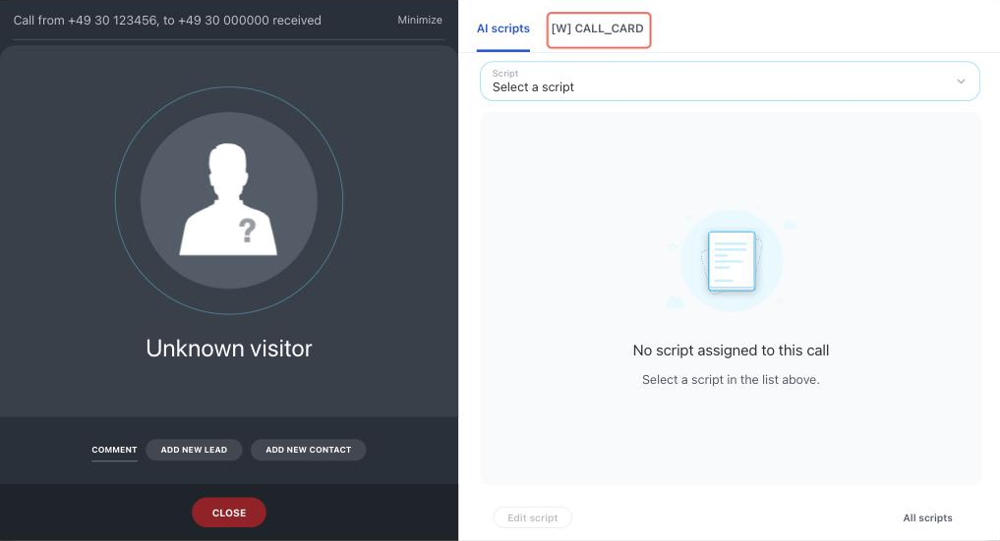

# Call Card Tab CALL_CARD



Choose a tool for developing with an AI agent:

- use [Alaio Vibecode](../../../ai-tools/vibecode.md) to build an app for Bitrix24 from a task description without knowing any programming language. The agent writes the code and deploys the app to a server, with no manual hosting setup
- use the [MCP server](../../../ai-tools/mcp.md) to develop a REST API integration in your own project. The agent refers to the official REST documentation



> Scope: [`placement, telephony`](../../scopes/permissions.md)

The widget adds its own tab to the call card. The handler receives the call context: call identifier, phone number, call direction and state, and the linked CRM items. You can use the placement to:

- show the operator client data from your own system
- suggest a conversation script based on the linked deal or lead
- record the outcome of the conversation in an external service

Choose this placement if the operator needs to see data during the call. For your own call report, use [{#T}](./analytics-menu.md).

The handler loads when the operator opens the application tab. The exception is a card without other tabs, for example without scripts, a call list, or a CRM form. In that case, the card opens the first application tab itself, and the handler loads as soon as the card opens.

The placement code is specified in the `PLACEMENT` parameter of the [placement.bind](../placement-bind.md) method. The method works only on behalf of an application: you cannot register the placement via a webhook. A widget can be registered by the Bitrix24 administrator and, in a local application, also by an employee with permission to create applications.



The widget is not displayed in the interface until the application installation is complete. [Check the application installation](../../../settings/app-installation/installation-finish.md)



## Where the Widget is Embedded

#|
|| **Placement Code** | **Location** ||
|| `CALL_CARD` | Tab in the call card ||
|#

### Where to Find It in the Interface

The call card appears for the employee when a call starts. In a call list, it opens even before the call — when the employee moves to a client from the list. The application tab is displayed on the right side of the card, in the same row as the built-in tabs.

The tab name is set with a parameter of the [placement.bind](../placement-bind.md) method during registration.

#|
|| **Parameter**
`type` | **Description** ||
|| **TITLE**
[`string`](../../data-types.md) | The tab name in the call card. If `LANG_ALL` is passed, the name is taken from it in the user's language. If neither is passed, the application name is displayed ||
|#

The name is translated into the user's language with the `LANG_ALL` parameter — as in the examples below.



To check the widget, you need a call. External telephony raises one with the [telephony.externalCall.register](../../telephony/telephony-external-call-register.md) method and the `SHOW` = 1 parameter, or with the [telephony.externalCall.show](../../telephony/telephony-external-call-show.md) method for a call that is already registered.

The list of card tabs is built when the Bitrix24 page loads. If you registered the widget while the page was already open, reload it — otherwise the new tab will not appear in the card.

## What the Handler Receives

Data is sent in a POST request: some parameters come in the handler URL query string, the rest in the request body {.b24-info}

```php
Array
(
    [DOMAIN] => xxx.bitrix24.com
    [PROTOCOL] => 1
    [LANG] => en
    [APP_SID] => 588b8a98e848778a4ffb38fbcf70f2b9
    [AUTH_ID] => 4172bb6600705a0700005a4b00000001f0f107c42ca5bd5f61030c5d9c3e4d60d11b5a
    [AUTH_EXPIRES] => 3600
    [REFRESH_ID] => 31f1e26600705a0700005a4b00000001f0f107b1918506d8a2ed9ecf76e8fdac962471
    [SERVER_ENDPOINT] => https://oauth.bitrix.info/rest/
    [APPLICATION_TOKEN] => 5b2f8c1d7e3a9046b8c5d2f1a7e3b904
    [APPLICATION_SCOPE] => telephony,crm,placement
    [member_id] => da45a03b265edd8787f8a258d793cc5d
    [status] => L
    [PLACEMENT] => CALL_CARD
    [PLACEMENT_OPTIONS] => {"CALL_ID":"externalCall.c3ee67f1a63f6e6117c230ab59cc49ea.1723556778","PHONE_NUMBER":"+4930123456","LINE_NUMBER":"+49 30 000-00-00","LINE_NAME":"+49 30 000-00-00","CRM_ENTITY_TYPE":"COMPANY","CRM_ENTITY_ID":"17","CRM_ACTIVITY_ID":"undefined","CRM_BINDINGS":[{"ENTITY_TYPE":"DEAL","ENTITY_ID":"25"},{"ENTITY_TYPE":"COMPANY","ENTITY_ID":"17"}],"CALL_DIRECTION":"incoming","CALL_STATE":"connected","CALL_LIST_MODE":"false","URI":"\/crm\/company\/details\/17\/"}
)
```





### PLACEMENT_OPTIONS {#placement-options}

The value of `PLACEMENT_OPTIONS` is passed as a JSON string with the call context.



#|
|| **Parameter** | **Description** ||
|| **CALL_ID***
[`string`](../../data-types.md) | The identifier of the call during which the widget was opened.

The [telephony.externalCall.register](../../telephony/telephony-external-call-register.md) method returns the same identifier. It is accepted by the methods that finish a call and attach a call recording.

In a call list, an empty string arrives before the call starts

||
|| **PHONE_NUMBER**
[`string`](../../data-types.md) | The phone number of the client the conversation is held with.

During a call, the number arrives in normalized form, without spaces or separators. In a call list, it arrives as recorded in CRM, for example `+49 (30) 000-77-09`. If there is no number, the string `undefined` arrives — for example, in a call list for a client without a phone number

||
|| **LINE_NUMBER**
[`string`](../../data-types.md) | The company's phone number that received the call or that the call is made from

||
|| **LINE_NAME**
[`string`](../../data-types.md) | The name of the company's phone line.

Lines are added by telephony integration applications with the [telephony.externalLine.add](../../telephony/telephony-external-line-add.md) method and are used in Sales Intelligence. If the line has no name, the key carries its number

||
|| **CRM_ENTITY_TYPE**
[`string`](../../data-types.md) | The symbolic code of the [CRM item type](../../crm/data-types.md#object_type) the call is linked to: `LEAD`, `DEAL`, `CONTACT`, `COMPANY`, and in a call list also `QUOTE` and `INVOICE`.

This is `entityTypeName`, not the numeric type identifier. If the call is not linked to CRM, the key arrives empty

||
|| **CRM_ENTITY_ID**
[`string`](../../data-types.md) | The identifier of the CRM item the call is linked to.

Knowing the type and the identifier, you can retrieve the item data:

- any object type — [crm.item.get](../../crm/universal/crm-item-get.md) with `entityTypeId` = '1' for leads, '2' for deals, and [etc.](../../crm/data-types.md#object_type)
- lead — [crm.lead.get](../../crm/leads/crm-lead-get.md)
- deal — [crm.deal.get](../../crm/deals/crm-deal-get.md)
- contact — [crm.contact.get](../../crm/contacts/crm-contact-get.md)
- company — [crm.company.get](../../crm/companies/crm-company-get.md)

If the call is not linked to CRM, the key carries `0`

||
|| **CRM_BINDINGS**
[`array`](../../data-types.md) | All CRM items linked to the call. The composition of an array element is [described below](#crm_bindings).

The `CRM_ENTITY_TYPE` and `CRM_ENTITY_ID` keys name the primary item only. If the call is linked to several items at once — for example, to a company and its deal — the full list arrives in `CRM_BINDINGS`.

If there are no linked items, the key is not passed at all. In a call list for contacts and companies, it is absent too: the item arrives only in `CRM_ENTITY_TYPE` and `CRM_ENTITY_ID`. In a call list for deals, estimates, and invoices that have a client specified, `CRM_ENTITY_TYPE` and `CRM_ENTITY_ID` carry the client, and `CRM_BINDINGS` carries the deal, estimate, or invoice itself

||
|| **CRM_ACTIVITY_ID**
[`string`](../../data-types.md) | The identifier of the [CRM activity](../../crm/timeline/activities/index.md) created for this call.

The [crm.activity.get](../../crm/timeline/activities/activity-base/crm-activity-get.md) method returns the activity data.

If no activity was created for the call, the string `undefined` arrives. For an external call from the [telephony.externalCall.register](../../telephony/telephony-external-call-register.md) method, it is always `undefined`: the activity is created by the [telephony.externalCall.finish](../../telephony/telephony-external-call-finish.md) method after the call. Check the value before using it

||
|| **CALL_DIRECTION***
[`string`](../../data-types.md) | The direction of the call. Possible values:

- `incoming` — incoming call
- `outgoing` — outgoing call
- `callback` — callback

||
|| **CALL_STATE**
[`string`](../../data-types.md) | The state of the call at the moment the widget is opened. Possible values:

- `idle` — the conversation has not started yet
- `connecting` — the connection is being established
- `connected` — active conversation

||
|| **CALL_LIST_MODE**
[`string`](../../data-types.md) | Indicates whether the call is made as part of a [call campaign](https://helpdesk.bitrix24.com/open/21815426/). The value arrives as a string: `true` or `false`

||
|#

Along with these keys, the universal `URI` key arrives — it is described above, in the standard data.

#### Composition of CRM_BINDINGS {#crm_bindings}

#|
|| **Key**
`type` | **Description** ||
|| **ENTITY_TYPE**
[`string`](../../data-types.md) | Symbolic code of the [CRM item type](../../crm/data-types.md#object_type): `LEAD`, `DEAL`, `CONTACT`, `COMPANY`, and in a call list also `QUOTE` and `INVOICE` ||
|| **ENTITY_ID**
[`string`](../../data-types.md) | Identifier of the CRM item ||
|#

This placement does not support the `OPTIONS` parameter of the [placement.bind](../placement-bind.md) method: the values passed are not retained, and in the [placement.get](../placement-get.md) response, the `options` field of such a registration is an empty array.

## Managing the Call Card From the Handler

The handler can do more than read the context: it can also work with the call card from the browser — retrieve the data of the current call, disable and re-enable the automatic closing of the card, and track the change of the client and of the call state. The card commands and events are described in the [{#T}](../ui-interaction/call-card/index.md) section.

## Code Examples





- cURL (OAuth)

    ```bash
    curl -X POST \
      -H "Content-Type: application/json" \
      -H "Accept: application/json" \
      -d '{
        "PLACEMENT": "CALL_CARD",
        "HANDLER": "https://your-domain.com/widgets/call-card-handler.php",
        "TITLE": "Customer profile",
        "LANG_ALL": {
          "en": {
            "TITLE": "Customer profile"
          },
          "de": {
            "TITLE": "Kundenprofil"
          }
        },
        "auth": "**put_access_token_here**"
      }' \
      https://**put_your_bitrix24_address**/rest/placement.bind
    ```

- JS (TS)

    ```ts
    // This snippet is an ES module: top-level await requires type="module" or a bundler.
    // $b24 is an already-initialized SDK instance (see the SDK "Get started" guide).
    import { Text } from '@bitrix24/b24jssdk'
    import type { B24Frame } from '@bitrix24/b24jssdk'

    declare const $b24: B24Frame

    try {
      const response = await $b24.actions.v2.call.make<boolean>({
        method: 'placement.bind',
        params: {
          PLACEMENT: 'CALL_CARD',
          HANDLER: 'https://your-domain.com/widgets/call-card-handler.php',
          TITLE: 'Customer profile',
          LANG_ALL: {
            en: {
              TITLE: 'Customer profile',
            },
            de: {
              TITLE: 'Kundenprofil',
            },
          },
        },
        requestId: Text.getUuidRfc4122()
      })

      // The payload is available only on a successful response
      if (!response.isSuccess) {
        console.error(response.getErrorMessages().join('; '))
      } else {
        const result = response.getData()!.result
        console.info('Placement bound successfully:', result)
      }
    } catch (error) {
      // Thrown on transport or SDK failures (AjaxError, SdkError, etc.)
      console.error(error)
    }
    ```

- JS (UMD)

    ```html
    <!-- Load the SDK (UMD build); it is exposed as the global B24Js -->
    <script src="https://unpkg.com/@bitrix24/b24jssdk@1/dist/umd/index.min.js"></script>
    <script>
      async function bindCallCard() {
        try {
          // Initialize the SDK inside a Bitrix24 frame
          const $b24 = await B24Js.initializeB24Frame()

          const response = await $b24.actions.v2.call.make({
            method: 'placement.bind',
            params: {
              PLACEMENT: 'CALL_CARD',
              HANDLER: 'https://your-domain.com/widgets/call-card-handler.php',
              TITLE: 'Customer profile',
              LANG_ALL: {
                en: {
                  TITLE: 'Customer profile',
                },
                de: {
                  TITLE: 'Kundenprofil',
                },
              },
            },
            requestId: B24Js.Text.getUuidRfc4122()
          })

          // The payload is available only on a successful response
          if (!response.isSuccess) {
            console.error(response.getErrorMessages().join('; '))
            return
          }

          const result = response.getData().result
          console.info('Placement bound successfully:', result)
        } catch (error) {
          // Thrown on transport or SDK failures (AjaxError, SdkError, etc.)
          console.error(error)
        }
      }

      document.addEventListener('DOMContentLoaded', bindCallCard)
    </script>
    ```

- PHP

    ```php
    try {
        $response = $b24Service
            ->core
            ->call(
                'placement.bind',
                [
                    'PLACEMENT' => 'CALL_CARD',
                    'HANDLER' => 'https://your-domain.com/widgets/call-card-handler.php',
                    'TITLE' => 'Customer profile',
                    'LANG_ALL' => [
                        'en' => [
                            'TITLE' => 'Customer profile',
                        ],
                        'de' => [
                            'TITLE' => 'Kundenprofil',
                        ],
                    ],
                ]
            );

        $result = $response->getResponseData()->getResult();

        print_r($result);
    } catch (Throwable $e) {
        echo $e->getMessage();
    }
    ```

- BX24.js

    ```js
    BX24.callMethod(
        'placement.bind',
        {
            PLACEMENT: 'CALL_CARD',
            HANDLER: 'https://your-domain.com/widgets/call-card-handler.php',
            TITLE: 'Customer profile',
            LANG_ALL: {
                en: { TITLE: 'Customer profile' },
                de: { TITLE: 'Kundenprofil' }
            }
        },
        function(result) {
            if (result.error()) {
                console.error(result.error());
            } else {
                console.log(result.data());
            }
        }
    );
    ```

- PHP CRest

    ```php
    require_once('crest.php');

    $result = CRest::call(
        'placement.bind',
        [
            'PLACEMENT' => 'CALL_CARD',
            'HANDLER' => 'https://your-domain.com/widgets/call-card-handler.php',
            'TITLE' => 'Customer profile',
            'LANG_ALL' => [
                'en' => [
                    'TITLE' => 'Customer profile',
                ],
                'de' => [
                    'TITLE' => 'Kundenprofil',
                ],
            ],
        ]
    );

    echo '<PRE>';
    print_r($result);
    echo '</PRE>';
    ```

- Go

    ```go
    // client and ctx are already created — see the Go SDK section
    res, err := client.Core().Call(ctx, "placement.bind", b24.Params{
    	"PLACEMENT": "CALL_CARD",
    	"HANDLER":   "https://your-domain.com/widgets/call-card-handler.php",
    	"TITLE":     "Customer profile",
    	"LANG_ALL": b24.Params{
    		"ru": b24.Params{
    			"TITLE": "Customer profile",
    		},
    		"en": b24.Params{
    			"TITLE": "Customer profile",
    		},
    	},
    })
    if err != nil {
    	return fmt.Errorf("placement.bind: %w", err)
    }

    // The response arrives as json.RawMessage — unmarshal it into a struct
    // matching the response shape from the "Response Handling" section of the placement.bind page.
    fmt.Printf("%s\n", res.Result)
    ```



If the registration succeeds, the method returns `result: true`. For the tab to appear in the call card, complete the application installation and reload the Bitrix24 page.

## Common Mistakes

#|
|| **Mistake** | **Solution** ||
|| [placement.bind](../placement-bind.md) returns `WRONG_AUTH_TYPE` with the description `Application context required` | Register the placement on behalf of an application. A placement cannot be bound with a webhook ||
|| [placement.bind](../placement-bind.md) returns `ERROR_PLACEMENT_NOT_FOUND` | The placement code is specified incorrectly or the application has not been granted the `telephony` scope ||
|| [placement.bind](../placement-bind.md) returns `ERROR_ARGUMENT` | Pass the required `PLACEMENT` and `HANDLER` parameters. The missing parameter is named in `error_description`, for example `Argument 'The URL of the placement handler is not specified' is null or empty` for an empty `HANDLER` ||
|| The widget is registered, but there is no tab in the call card | Complete the [application installation](../../../settings/app-installation/installation-finish.md) and reload the Bitrix24 page: the list of card tabs is assembled when the page loads ||
|| The handler received the wrong call data: no activity identifier, the CRM item type is not recognized, a linked item is missing | See the [PLACEMENT_OPTIONS](#placement-options) section: the activity identifier can arrive as the string `undefined`, the item type arrives as a symbolic code, and all linked items arrive in `CRM_BINDINGS` ||
|#

The error arrives in the response body — the code in the `error` field, the text in `error_description`:

```json
{
    "error": "WRONG_AUTH_TYPE",
    "error_description": "Current authorization type is denied for this method Application context required"
}
```

Other registration error codes are listed in the "Possible Error Codes" section of the [placement.bind](../placement-bind.md) page.

## Continue Your Exploration

- [{#T}](./index.md)
- [{#T}](./analytics-menu.md)
- [{#T}](./webrtc.md)
- [{#T}](../placement-bind.md)
- [{#T}](../../telephony/telephony-external-call-register.md)
- [{#T}](../ui-interaction/index.md)
- [{#T}](../bx24-widget-methods.md)
- [{#T}](../../../settings/interactivity/index.md)
