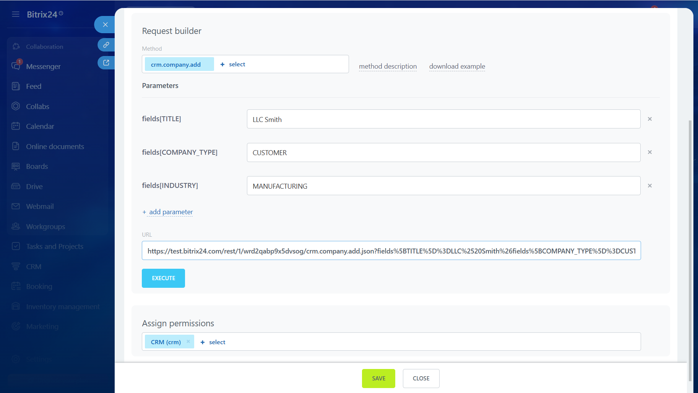
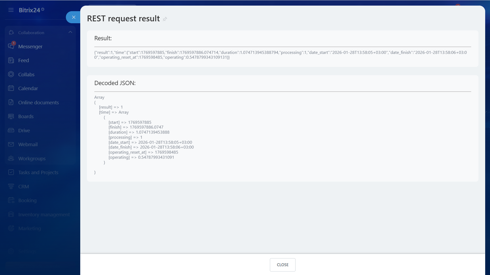
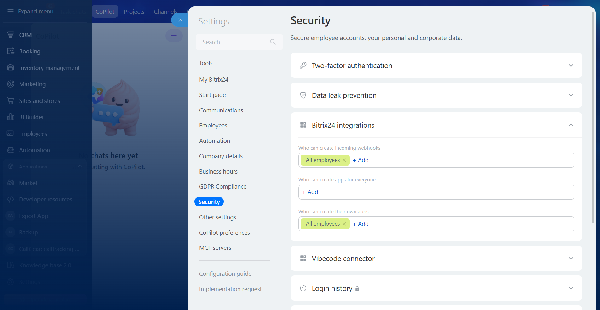

# How to Make Your First API Request



Choose a tool for developing with an AI agent:

- use [Alaio Vibecode](../ai-tools/vibecode.md) to build an app for Bitrix24 from a task description without knowing any programming language. The agent writes the code and deploys the app to a server, with no manual hosting setup
- use the [MCP server](../ai-tools/mcp.md) to develop a REST API integration in your own project. The agent refers to the official REST documentation



To make your first request to the REST API, create an inbound webhook. This is a ready-to-use tool for calling API methods with the permissions of the user who created the webhook.

You can check the webhook with the [profile](../api-reference/common/users/profile.md) method: it does not change anything in Bitrix24 and returns your data — first name, last name, and ID. If the request fails, the error code points to the cause. Once the webhook works, choose an authorization method for your production integration: a webhook or an application.

## How to Create an Inbound Webhook

1. In the Bitrix24 left menu, open the *Developer resources* section
2. Go to the *Common use cases > Other > Inbound webhook* tab. A slider will appear containing the pre-generated webhook code
3. In the *Assign permissions* block, select scopes — groups of methods the webhook will have access to. For the [first check](#check) with the [profile](../api-reference/common/users/profile.md) method, no scope is needed
4. Copy the URL from the *Webhook to call REST API* field
5. Click *Create*. Bitrix24 saves the webhook and opens the *Integrations* list, where you can find it later

If the *Inbound webhook* item is missing, ask the administrator to [enable access to webhook creation](#webhook-app-access). If a plan upgrade window opens instead of the slider, [enable REST API access](./access-to-rest-api.md).

Requests via a webhook are executed with the permissions of the user who created it and only within the selected scopes. The scope a method requires is listed on its page. For details, see the [list of Bitrix24 scopes](../api-reference/scopes/permissions.md).

## Request Builder

Below the webhook code is the *Request builder* block. You can use it to select a method, specify parameters, and run the request right away. If the webhook slider is already closed, open the webhook in the *Integrations* list.

1. Select a method from the list. By default, [profile](../api-reference/common/users/profile.md) is selected; it does not change any data. If the required method is not in the list, select its scope in the *Assign permissions* block, save the webhook, and enter the method name in the URL

   The screenshot shows the [crm.company.add](../api-reference/crm/companies/crm-company-add.md) method selected as an example; it creates a company.

   

2. Specify the method parameters if necessary
3. Click *Execute*. The builder sends the request and shows the response in JSON format

   The screenshot shows the [crm.company.add](../api-reference/crm/companies/crm-company-add.md) response: the `result` field contains the identifier of the created company.

   

## Webhook URL Structure

An external system calls methods using the webhook URL. You can copy it from the *Webhook to call REST API* field or from the request builder.

Example URL:

```http
https://your-company.bitrix24.com/rest/1/8v5m0dmbxs2ky7wq/department.get.json?ID=1
```

The URL consists of several parts:

- `your-company.bitrix24.com` — the Bitrix24 address
- `/rest` — indication of REST API access
- `/1` — the identifier of the user who created the webhook
- `/8v5m0dmbxs2ky7wq` — the secret webhook code
- `/department.get` — the called REST API method, here [department.get](../api-reference/departments/department-get.md)
- `.json` — the response format; it can be omitted
- `?ID=1` — method parameters



Never share the secret webhook code and do not embed it in public web page code or scripts. Do not store it in logs or repositories. Grant the webhook only the scopes your integration needs.



## How to Check the Webhook {#check}

Use the [profile](../api-reference/common/users/profile.md) method for the check: it takes no parameters and needs no separate scope. Append the method name to the webhook URL and open the address in a browser:

```http
https://your-company.bitrix24.com/rest/1/8v5m0dmbxs2ky7wq/profile
```

After the check, delete this address from your browser history: it contains the secret webhook code.

If the webhook works, Bitrix24 returns the data of the user who created it. The `result` field contains the data, and the `time` field contains request metadata. See the [profile](../api-reference/common/users/profile.md) method page for the full response and field descriptions.

Abbreviated response:

```json
{
    "result": {
        "ID": "1",
        "ADMIN": true,
        "NAME": "Klaus",
        "LAST_NAME": "Weber"
    },
    "time": {
        "duration": 0.0401120185852051
    }
}
```

If the response looks like this, move on to the examples on method pages. The [{#T}](./how-to-use-examples.md) article explains how to run them.

## Errors and Diagnostics {#errors}

If the request fails, Bitrix24 returns the `error` and `error_description` fields instead of `result`. This is how methods of the [previous API version](../api-reference/index.md#version) respond, and the examples on this page use that version. Here is the response when the webhook lacks the required scope:

```json
{
    "error": "insufficient_scope",
    "error_description": "The request requires higher privileges than provided by the webhook token"
}
```

Common first-request errors:

#|
|| **Error code** | **Cause** | **What to do** ||
|| `INVALID_CREDENTIALS` | There is no active webhook with this user identifier and code: the URL contains an error, the webhook was deleted, or it has expired | Copy the URL again from the *Webhook to call REST API* field. If the webhook has expired, click *Generate new* below the field, confirm the action, and replace the URL in your integration. If the webhook was deleted, create a new one ||
|| `insufficient_scope` | The webhook does not have the scope that includes the method | Select the scope in the *Assign permissions* block and save the webhook ||
|| `ERROR_METHOD_NOT_FOUND` | The method name contains a typo, or the method does not exist in Bitrix24 | Check the name against the method page in the [API Reference](../api-reference/index.md) ||
|| `ACCESS_DENIED` with status `401` and the description `REST is available only by subscription.` | REST API access is not included in the current plan | [Enable REST API access](./access-to-rest-api.md) ||
|| An access error, for example `ACCESS_DENIED` | The user who created the webhook does not have permissions for the object or action | Grant the user the required permissions or ask an employee who has them to create the webhook ||
|#

Method-specific errors are described on the method page in the "Error Handling" section. Common codes are listed in the [{#T}](../error-codes.md) article.

## How to Configure Access to Webhook Creation for Employees {#webhook-app-access}

A Bitrix24 administrator can allow all employees or selected users to create webhooks.

1. Open *Settings > Bitrix24 settings*. The section is available only to employees with administrator permissions
2. In the new window, go to *Security > Bitrix24 integrations*
3. In the *Who can create inbound webhooks* field, click *Add* and select all employees or selected users
4. Click *Save* at the bottom of the window





The *Permission source — Vibecode server* option in the *Vibecode connector* block does not affect webhooks that employees create in the *Developer resources* section. It applies only to keys and applications issued by Alaio Vibecode. If the option is enabled, the permission to create them is determined by the Vibecode server, not by the *Who can create inbound webhooks* field.



## Other Ways to Work with the API

Inbound webhooks are suitable for personal use and internal scenarios where requests are executed on behalf of a single user. For local applications that will run for different users, use OAuth 2.0. Mass-market applications for the Bitrix24 Market also require OAuth 2.0 and registration.

Some methods, such as [widget embedding methods](../api-reference/widgets/index.md), are not available via a webhook: they require an application context. For details, see the [{#T}](../local-integrations/local-webhooks.md) article.

- To register local applications, go to the *Common use cases > Other > Local application* tab. If the *Local application* item is missing, ask the administrator to configure access to application creation in the same way as access to webhook creation
- To list applications in the Market, become a partner program member: fill out the application form on the [Developer's area website](https://vendors.bitrix24.com/technology-partnership/)

## Continue Learning

- [{#T}](./how-to-use-examples.md)
- [{#T}](../local-integrations/local-apps.md)
- [{#T}](../market/index.md)
- [{#T}](../settings/oauth/index.md)
