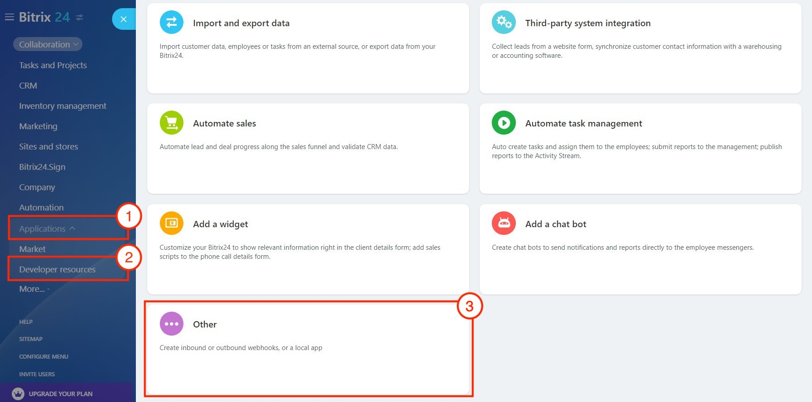
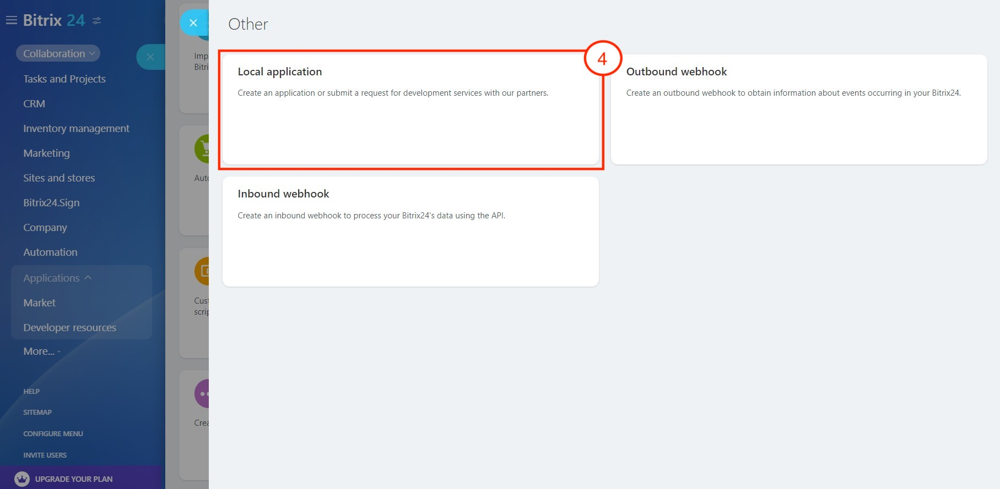
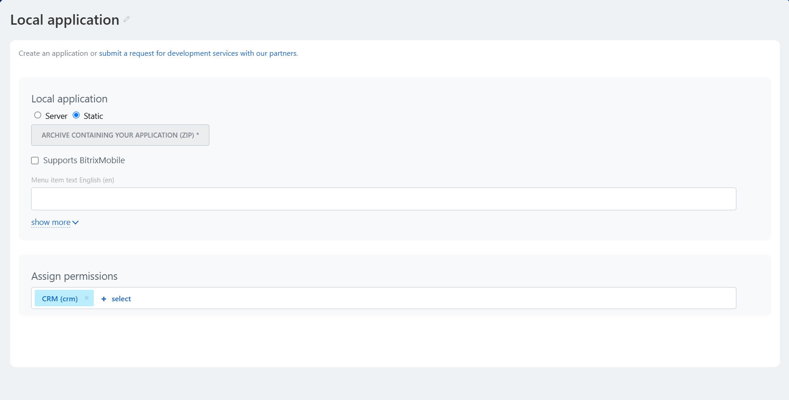
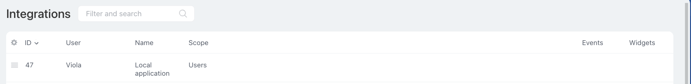

# Static Local Application



Choose a tool for developing with an AI agent:

- use [Alaio Vibecode](../ai-tools/vibecode.md) to build an app for Bitrix24 from a task description without knowing any programming language. The agent writes the code and deploys the app to a server, with no manual hosting setup
- use the [MCP server](../ai-tools/mcp.md) to develop a REST API integration in your own project. The agent refers to the official REST documentation



A static local application is an HTML page with JavaScript that Bitrix24 opens in a frame within its interface. This option is suitable when the application needs an interface in Bitrix24 but does not need its own server.

If you need to run code on your own server, store secrets there, or receive Bitrix24 events, choose a [server-side local application with a user interface](./serverside-local-app-with-ui.md).



The method described below for uploading a static local application is intended for Bitrix24 cloud accounts.

For Bitrix24 On-premise, upload the application to a folder in the account's file structure and specify that folder as the handler path.



## Prepare the Archive

Place the `index.html` file in the root of the ZIP archive. This file serves as the application's main page. You can add CSS, JavaScript, images, and other files to the archive and connect them to `index.html` using relative paths.

If setup is required before the first launch, add an `install.html` file to the archive root. Bitrix24 will open it as an [installation wizard](../settings/app-installation/local-apps/installation-master.md).

The following `index.html` example retrieves the current user's name using [user.current](../api-reference/user/user-current.md):

```html
<!doctype html>
<html lang="en">
<head>
    <meta charset="utf-8">
    <title>Current User</title>
    <script src="//api.bitrix24.com/api/v1"></script>
</head>
<body>
    <p id="user-name">Loading...</p>

    <script>
        BX24.init(() => {
            BX24.callMethod('user.current', {}, (result) => {
                const output = document.getElementById('user-name');

                if (result.error())
                {
                    output.textContent = 'Failed to retrieve user data';
                    console.error(result.error());
                    return;
                }

                const user = result.data();
                output.textContent = [user.NAME, user.LAST_NAME]
                    .filter(Boolean)
                    .join(' ');
            });
        });
    </script>
</body>
</html>
```

The example uses [BX24.js](../sdk/bx24-js-sdk/index.md). When the application opens in a frame, the library retrieves authorization data from the Bitrix24 environment and uses it in REST API calls. Therefore, you do not need to store a webhook, `client_secret`, or OAuth tokens in the static application code.

## Create the Application

1. Open *Applications > Developer resources > Other > Local application*. If the *Local application* item is missing, ask the administrator to [configure access to application creation](./local-apps.md#local-app-access)
    

    
2. Select *Static*
    
3. Upload the application ZIP archive in the *Archive containing your application (zip)* field
4. Enable *Supports BitrixMobile* if the application must work in the Bitrix24 mobile app
5. Fill in the *Menu item text English (en)* field
6. In the *Assign permissions* section, select the permissions required for the application's REST API calls
7. Click *Create*

After creation, the application appears in *Applications > Developer resources > Integrations*.



REST API calls are made on behalf of the employee who opened the application. Method availability is limited by the employee's permissions and the permissions selected when creating the application.

## Add a Widget {#widgets}

A static application can embed its pages in the Bitrix24 interface as [widgets](../api-reference/widgets/index.md) — for example, add a tab to the company card. The widget handler is an HTML page from the same archive.

As an example, add a `contacts.html` page to the archive and register it as a company card tab `CRM_COMPANY_DETAIL_TAB`. When creating the application, select the `crm` and `placement` permissions.

### Handler Address

Bitrix24 places all archive files in a single folder and retains only the addresses of `index.html` and `install.html` in the application settings. Build the address of any other page relative to the page that is currently open:

```js
const handler = new URL('contacts.html', location.href).href.split('?')[0];
// https://apps-b1234567.bitrix24-cdn.com/b1234567/app_local/899dc6eb61c4c5a88228db3e189b83cd/contacts.html
```

The domain and the folder path depend on the Bitrix24 account, so do not hardcode the address.

### Registering the Widget

Register the tab with the method [placement.bind](../api-reference/widgets/placement-bind.md) from the `index.html` code. The call succeeds if the application was opened by the Bitrix24 administrator or by an employee with the *Who can create apps for everyone* permission — how to grant it is described in [How to Configure Access to Application Creation](./local-apps.md#local-app-access). For other employees, the method returns the `ACCESS_DENIED` error.

```js
BX24.init(() => {
    BX24.callMethod('placement.bind', {
        PLACEMENT: 'CRM_COMPANY_DETAIL_TAB',
        HANDLER: new URL('contacts.html', location.href).href.split('?')[0],
        TITLE: 'Contacts',
    }, (result) => {
        if (result.error())
        {
            console.error(result.error());
        }
    });
});
```

Registering the same address for the same placement again returns the `Handler already binded` error. To check which widgets are already registered, call [placement.get](../api-reference/widgets/placement-get.md).

### Widget Data

The handler page retrieves the placement code and its parameters with the method [BX24.placement.info](../api-reference/widgets/ui-interaction/bx24-placement-info.md) after `BX24.init`. A static page cannot read them from the request body.

```html
<!doctype html>
<html lang="en">
<head>
    <meta charset="utf-8">
    <script src="//api.bitrix24.com/api/v1"></script>
</head>
<body>
    <p id="company">Loading...</p>

    <script>
        BX24.init(() => {
            const info = BX24.placement.info();
            // {"placement": "CRM_COMPANY_DETAIL_TAB", "options": {"ID": "1", ...}}
            document.getElementById('company').textContent = 'Company ID: ' + info.options.ID;
        });
    </script>
</body>
</html>
```

### Replacing the Archive

When you replace the archive, Bitrix24 moves the files to a new folder and deletes the old one. The addresses of `index.html` and `install.html` in the application settings are updated automatically. The widget addresses registered with `placement.bind` stay the same and point to deleted files, so the tab in the card shows a 404 error.

After every archive replacement, register the widgets again:

1. Retrieve the list of widgets with the method [placement.get](../api-reference/widgets/placement-get.md)
2. Remove the widgets with old addresses with the method [placement.unbind](../api-reference/widgets/placement-unbind.md)
3. Register them again with `placement.bind` using addresses from the new folder

`install.html` does not open after the archive is replaced, because the application is already installed. It is therefore convenient to run the check in `index.html` every time it opens: if a widget address does not start with the address of the current folder `new URL('./', location.href)`, register the widget again.

To replace the archive, open the application for editing in the *Applications > Developer resources > Integrations* list. If the form opens with the *Server* type selected, switch it to *Static* — the archive upload field appears.

## Continue Exploring

- [{#T}](local-apps.md)
- [{#T}](../sdk/bx24-js-sdk/index.md)
- [{#T}](serverside-local-app-with-ui.md)
- [{#T}](serverside-local-app-with-no-ui.md)
