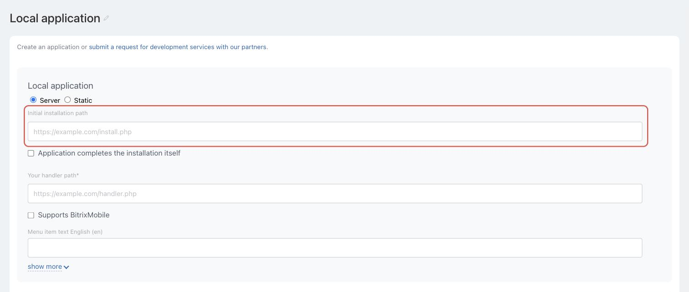
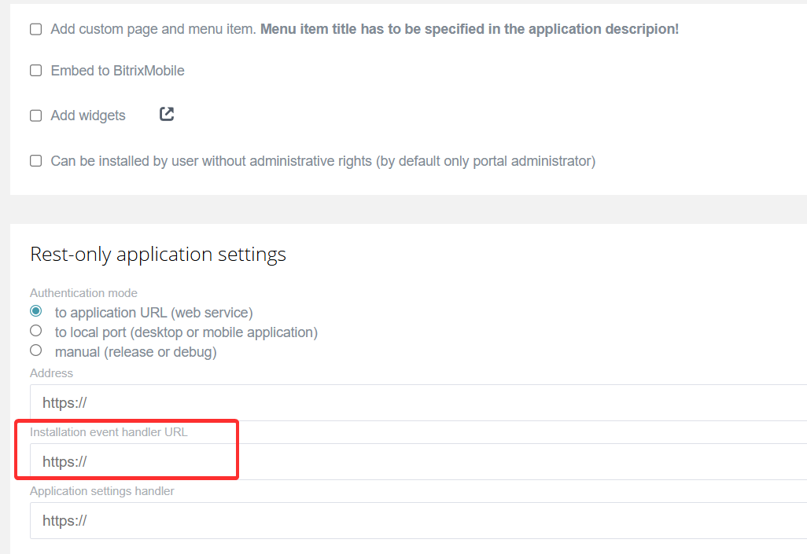
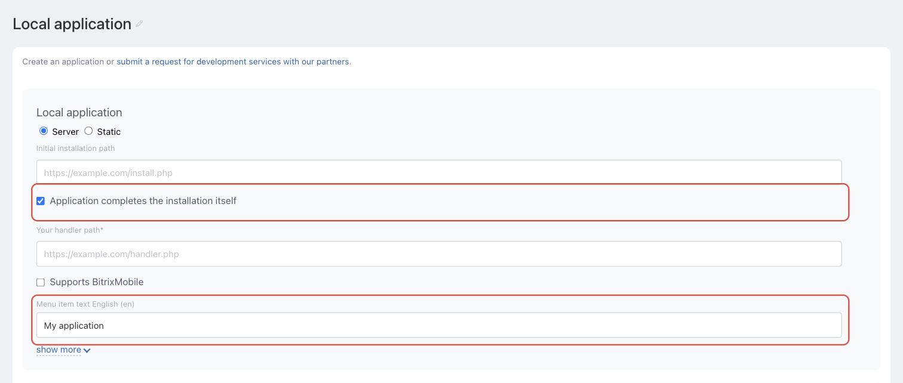
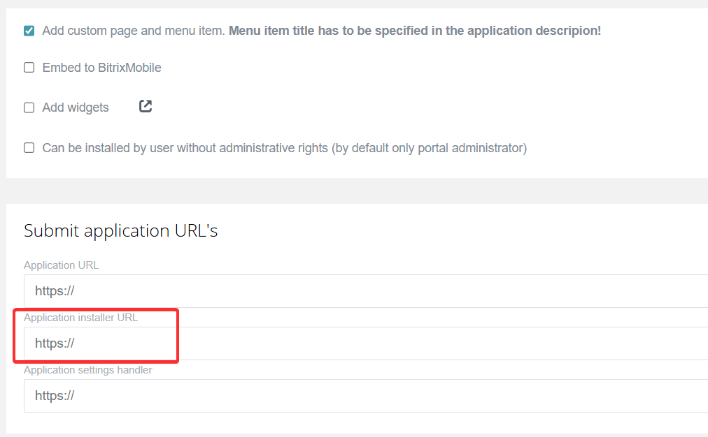

# Completing Application Installation



Choose a tool for developing with an AI agent:

- use [Alaio Vibecode](../../ai-tools/vibecode.md) to build an app for Bitrix24 from a task description without knowing any programming language. The agent writes the code and deploys the app to a server, with no manual hosting setup
- use the [MCP server](../../ai-tools/mcp.md) to develop a REST API integration in your own project. The agent refers to the official REST documentation



How the installation completes depends on whether the application has an installation wizard. Without a wizard, Bitrix24 considers the application installed right away. With a wizard, the application completes the installation itself with the `installFinish` function once the user finishes the setup. The application is installed by a Bitrix24 administrator or by an employee whom the administrator has allowed to install applications.

## Installation Without a Wizard

Bitrix24 installs the application itself and considers it installed right away. This is how both an application without an interface and an application with its own page that needs no initial setup are installed. There is no wizard if:

- for a local application, the *Application completes the installation itself* option is disabled, which is the default
- for a mass-market application, the *Application installer URL* field is empty or the *Add your page and item to the main menu* option is disabled

If an installation handler address is specified, Bitrix24 sends an [ONAPPINSTALL](../../api-reference/common/events/on-app-install.md) event to it in a POST request, with OAuth 2.0 authorization data in the `auth` object. For a local application, the address is set in the *Initial installation path* field; for a mass-market application, in the *Installation event handler URL* field.





The handler checks that the request came from Bitrix24 and stores the tokens. How to do this is described in the articles about the installation callback of a [local](./local-apps/installation-callback.md) and a [mass-market](./mass-market-apps/installation-callback.md) application.

## Installation with a Wizard

An installation wizard is an application page where the administrator configures the application before it starts working. The wizard opens if:

- for a local application, the *Initial installation path* field is filled in and the *Application completes the installation itself* option is enabled

   

- for a mass-market application, the *Add your page and item to the main menu* option is enabled and the *Application installer URL* field is filled in

   

Until the wizard page calls `installFinish`, Bitrix24 considers the application not installed and blocks it. A widget is an application interface inside Bitrix24, for example, a tab in the deal card.

- widgets do not appear in the interface, even if [placement.bind](../../api-reference/widgets/placement-bind.md) completed successfully
- events are not sent to the handler, even after a successful [event.bind](../../api-reference/events/event-bind.md)
- the administrator and employees allowed to install applications see the wizard page, and everyone else sees the message *"The application has not yet been completely installed. Please contact your Bitrix24 administrator to complete the installation"*

You can check whether the installation is complete with the [app.info](../../api-reference/common/system/app-info.md) method: the `INSTALLED` field in the response is `true` or `false`. The method requires only the basic scope, and any user can call it.

## How to Call installFinish

Call `installFinish` on the wizard page once, after the application has completed the setup: registered widgets, subscribed to events, and stored the configuration. The function works only in the application frame in a browser. After the call, Bitrix24 reloads the application page, so code after `installFinish` may not run.

In the examples, the application registers a tab in the deal card and subscribes to the deal creation event, then completes the installation. The application needs the `placement` and `crm` scopes. Replace the `https://example.com/...` addresses with the addresses of your handlers.

If the installation was interrupted, check which widgets and handlers are already registered with the [placement.get](../../api-reference/widgets/placement-get.md) and [event.get](../../api-reference/events/event-get.md) methods before trying again.



- JS

    [installFinish()](https://bitrix-tools.github.io/b24jssdk/docs/working-with-the-rest-api/frame/#installfinish)

    ```javascript
    import { initializeB24Frame } from '@bitrix24/b24jssdk'

    const $b24 = await initializeB24Frame();

    const placement = await $b24.actions.v2.call.make({
        method: 'placement.bind',
        params: {
            PLACEMENT: 'CRM_DEAL_DETAIL_TAB',
            HANDLER: 'https://example.com/deal-tab',
            TITLE: 'Application Data'
        }
    });

    const event = await $b24.actions.v2.call.make({
        method: 'event.bind',
        params: {
            event: 'ONCRMDEALADD',
            handler: 'https://example.com/event-handler'
        }
    });

    if (placement.isSuccess && event.isSuccess) {
        await $b24.installFinish();
    } else {
        console.error([...placement.getErrorMessages(), ...event.getErrorMessages()]);
    }
    ```

- BX24.js

    [BX24.installFinish()](../../sdk/bx24-js-sdk/system-functions/bx24-install-finish.md)

    ```javascript
    BX24.init(function() {
        BX24.callBatch({
            placement: ['placement.bind', {
                PLACEMENT: 'CRM_DEAL_DETAIL_TAB',
                HANDLER: 'https://example.com/deal-tab',
                TITLE: 'Application Data'
            }],
            event: ['event.bind', {
                event: 'ONCRMDEALADD',
                handler: 'https://example.com/event-handler'
            }]
        }, function(result) {
            if (result.placement.error() || result.event.error()) {
                console.error(result.placement.error(), result.event.error());
                return;
            }

            BX24.installFinish();
        });
    });
    ```



After installation, open the application as an employee without administrator rights: the interface should load, and the widgets should appear in the deal card.

## Continue Learning

- [{#T}](./index.md)
- [{#T}](./local-apps/installation-master.md)
- [{#T}](./mass-market-apps/installation-master.md)
- [{#T}](../../api-reference/common/system/app-info.md)
