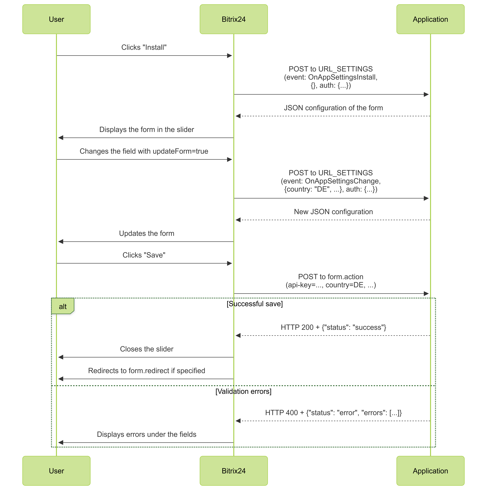

# Configuration wizard for REST-only applications



Choose a tool for developing with an AI agent:

- use [Alaio Vibecode](../../../ai-tools/vibecode.md) to build an app for Bitrix24 from a task description without knowing any programming language. The agent writes the code and deploys the app to a server, with no manual hosting setup
- use the [MCP server](../../../ai-tools/mcp.md) to develop a REST API integration in your own project. The agent refers to the official REST documentation



The REST-only application configuration wizard is a built-in Bitrix24 form for mass-market applications without a user interface. During development, it is sufficient to describe the fields in JSON format. Bitrix24 will automatically generate a step-by-step form, collect the data, and send it to the specified handler. Other installation options for a mass-market application are compared in the overview [{#T}](./index.md).

The configuration wizard is suitable if:

- the application has no interface of its own
- simple configurations are required: entering text in a single-line field, selecting an option from a list
- the configuration form should look like the Bitrix24 interface
- data from the [installation event callback handler](./installation-callback.md) is insufficient

## How the wizard works

Bitrix24 requests the configuration form from the application at the address from the `URL_SETTINGS` parameter. Specify this address in the *Application settings* field when registering an application in the developer console, in the REST-only section. Then, after installing the application, the user will see a slider with a configuration form.

If `URL_SETTINGS` is not set, Bitrix24 will not request the configuration, and the configuration form will not open.

### Form lifecycle

1. The user installs the application
2. Bitrix24 makes a POST request to `URL_SETTINGS` with the `event: OnAppSettingsInstall` parameter
3. The application returns a JSON form configuration
4. Bitrix24 displays the form in a slider — a panel that opens over the Bitrix24 page
5. If the user selects an option in a `dropdown-list` field with `updateForm: true`, Bitrix24 requests `URL_SETTINGS` again with the `event: OnAppSettingsChange` parameter
6. The user clicks *Save*, and the data is sent to `form.action`
7. The application returns `success` or a list of errors. After a successful save, Bitrix24 closes the slider, or, if `form.redirect` is set, navigates to that address instead



## JSON configuration structure

The configuration consists of three blocks:

- a header
- steps with fields
- saving parameters

### Header

The header defines the name of the settings page and the builder version.

```json
{
  "title": "Master Name",
  "version": "1"
}
```



#|
|| **Name**
`type` | **Description** ||
|| **title***
`string` | Interface heading ||
|| **version**
`string` | Builder version, `"1"` ||
|#

### Steps

`steps` is an array of steps. Each step is a separate block of the form with its own heading and fields.

```json
{
  "id": "step1",
  "title": "API Key",
  "description": "Enter access key",
  "fields": [
    {
      "id": "api-key",
      "name": "api-key",
      "type": "input",
      "label": "API Key",
      "placeholder": "Enter API key"
    }
  ]
}
```



#|
|| **Name**
`type` | **Description** ||
|| **id***
`string` | Unique step identifier ||
|| **title**
`string` | Step heading ||
|| **description**
`string` | Explanatory text ||
|| **fields**
`array` | Array of the step's fields, [detailed description](#fields) ||
|#

#### Parameter fields {#fields}



#|
|| **Name**
`type` | **Description** ||
|| **id**
`string` | Field identifier. If not set, Bitrix24 generates it automatically ||
|| **name***
`string` | Field name, key in data ||
|| **type***
`string` | Field type:
- `input` — single-line input field
- dropdown-list — list ||
|| **label**
`string` | Label above the field. Works only for the `input` field ||
|| **placeholder**
`string` | Placeholder inside the field. Works only for the `input` field ||
|| **value**
`string` | Default value ||
|| **items**
`array` | Options for `dropdown-list`. Each option is an object with the fields `value`, the value that arrives in the form data, and `name`, the label in the list ||
|| **updateForm**
`boolean` | Form refresh flag on option selection. Works only for the `dropdown-list` field ||
|#

You can change the form while the user is filling it out. For example, after a country is selected, show a field with a list of its regions. To do this, set the `updateForm: true` parameter for a `dropdown-list` field: after an option is selected, Bitrix24 requests `URL_SETTINGS` again and passes the current field values in the request.

Return the entire form configuration in response to such a request. Bitrix24 rebuilds the form from the response, so carry the values from `data` over to the `value` parameters of the fields; otherwise, the entered data is reset.

### Saving parameters

The `form` block describes where to send the data and which buttons to show.

```json
{
  "form": {
    "id": "config-form",
    "action": "https://example.com/save-handler.php",
    "clientId": "app.123...",
    "redirect": "/crm/",
    "saveCaption": "Save",
    "cancelCaption": "Cancel"
  }
}
```



#|
|| **Name**
`type` | **Description** ||
|| **id**
`string` | Form identifier ||
|| **action***
`string` | Save handler URL ||
|| **clientId***
`string` | Application identifier client_id ||
|| **redirect**
`string` | Path inside Bitrix24 to navigate to after a successful save, for example `/crm/`. The value must start with `/` or with the address of this Bitrix24; otherwise, Bitrix24 ignores it ||
|| **saveCaption**
`string` | "Save" button label ||
|| **cancelCaption**
`string` | "Cancel" button label ||
|#

## Configuration example

```json
{
  "title": "Storecove e-invoice connector",
  "version": "1",
  "steps": [
    {
      "id": "step1",
      "title": "API Key",
      "description": "Specify the key from your Storecove account",
      "fields": [
        {
          "id": "api-key",
          "name": "api-key",
          "type": "input",
          "label": "Storecove API Key",
          "placeholder": "Enter API key"
        }
      ]
    },
    {
      "id": "step2",
      "title": "Country",
      "fields": [
        {
          "id": "country",
          "name": "country",
          "type": "dropdown-list",
          "value": "DE",
          "items": [
            { "value": "RU", "name": "United States" },
            { "value": "DE", "name": "Germany" },
            { "value": "US", "name": "United States" }
          ],
          "updateForm": true
        }
      ]
    },
    {
      "id": "step3",
      "title": "Company details",
      "fields": [
        {
          "id": "vat-id",
          "name": "vat-id",
          "type": "input",
          "label": "VAT ID",
          "placeholder": "Enter VAT ID"
        }
      ]
    }
  ],
  "form": {
    "id": "config-form",
    "action": "https://example.com/save.php",
    "clientId": "app.6537665f598492.98090704",
    "redirect": "/",
    "saveCaption": "Connect",
    "cancelCaption": "Later"
  }
}
```

## URL_SETTINGS handler

Bitrix24 requests the form configuration with a POST request to `URL_SETTINGS` if the user has access to the application. The data arrives in the `application/x-www-form-urlencoded` format, and in PHP it is available in `$_POST`. Below, the request structure is shown in JSON for clarity. The `event` parameter shows why the request was sent: `OnAppSettingsInstall`, `OnAppSettingsDisplay`, or `OnAppSettingsChange`. These are not separate events but request scenarios.

In response to the request, the application must return a JSON form configuration. If the response is correct, Bitrix24 will display the form in the interface.

### Call scenarios

In the examples, the `auth` object is abbreviated.

`OnAppSettingsInstall` is passed after the application is installed.

```json
{
  "event": "OnAppSettingsInstall",
  "auth": {}
}
```

`OnAppSettingsDisplay` is passed when a user manually opens the settings from the application card. To display the current values to the user, return the configuration with the stored settings in each field's `value` parameter.

```json
{
  "event": "OnAppSettingsDisplay",
  "auth": {}
}
```

`OnAppSettingsChange` is passed when a user changes the value of a field with the `updateForm: true` parameter. An object is additionally passed in the request `data` with the current field values.

```json
{
  "event": "OnAppSettingsChange",
  "data": {
    "api-key": "cc1107f4-...",
    "country": "DE"
  },
  "auth": {}
}
```

Example of a POST request in PHP:

```php
[
  'event' => 'OnAppSettingsInstall', // or OnAppSettingsChange / OnAppSettingsDisplay
  'data'  => [ /* current field values */ ],
  'auth'  => [
    'access_token' => '***',
    'expires' => 1768385511,
    'expires_in' => 3600,
    'scope' => 'crm,bizproc,appform,user_brief,placement,catalog',
    'domain' => 'some-domain.bitrix24.com',
    'server_endpoint' => 'https://oauth.bitrix.info/rest/',
    'status' => 'F',
    'client_endpoint' => 'https://some-domain.bitrix24.com/rest/',
    'member_id' => '***',
    'refresh_token' => '***',
    'user_id' => 431,
    'client_id' => '***',
    'application_token' => '***'
  ]
]
```

#|
|| **Name**
`type` | **Description** ||
|| **event**
`string` | Request scenario:
- `OnAppSettingsInstall` — after application installation
- `OnAppSettingsDisplay` — when opening application settings
- `OnAppSettingsChange` — when changing a field with `updateForm: true` ||
|| **data**
`object` | Current form field values. Passed for `OnAppSettingsChange` ||
|| **auth**
`object` | Authorization data ||
|#

## Post-save handler

When a user clicks *Save*, Bitrix24 sends the form data to the address specified in the `form.action` field.

```php
$_POST = [
  'data' => [
    'api-key' => 'cc1107f4-...',
    'country' => 'DE',
    // other fields by name (name)
  ],
  'auth' => [
    // authorization data, as in the request to URL_SETTINGS
  ]
];
```

`input` fields that the user left empty are not passed in `data`.

Example of reading data:

```php
$data = $_POST['data'] ?? [];
$apiKey = $data['api-key'] ?? null;
$country = $data['country'] ?? null;
```

### Successful response

Bitrix24 considers the data saved if the handler returned valid JSON with HTTP status 200. Bitrix24 does not check the `status` field. After a successful save, the slider closes, or, if the `form.redirect` parameter is set, Bitrix24 navigates to that address instead.

```php
http_response_code(200);
header("Content-Type: application/json");
echo json_encode(['status' => 'success']);
```

### Error response

If the data is incorrect, return an HTTP status other than 200, for example 400, and the `errors` array. In each error, specify the `name` value of the field from the configuration in `field`. The form does not show an error without `field`. If the `errors` array is empty, Bitrix24 considers the save successful even with a status other than 200.

```php
http_response_code(400);
header("Content-Type: application/json");
echo json_encode([
  'status' => 'error',
  'errors' => [
    ['field' => 'api-key', 'message' => 'Invalid API key format'],
    ['field' => 'country', 'message' => 'Country is required']
  ]
]);
```

Bitrix24 displays errors under the corresponding fields. You can return multiple errors for a single field.

#### Example handler for returning a status

The example requires your storage's `loadApplicationToken()` function and a `/var/app-data` directory that PHP can write to.

Before saving, the handler checks that the request came from Bitrix24: it compares `auth.application_token` with the token that the application stored for this `member_id` during installation. The form opens after installation, so the token should already have been stored by then. If it is missing, reject the request. How to receive and store the token is described in the article [{#T}](../../../api-reference/events/safe-event-handlers.md).

```php
<?php
$data = $_POST['data'] ?? [];
$auth = $_POST['auth'] ?? [];
$memberId = (string)($auth['member_id'] ?? '');

// application_token stored during application installation for this Bitrix24
$savedToken = loadApplicationToken($memberId); // your storage function

if ($savedToken === '' || !hash_equals($savedToken, (string)($auth['application_token'] ?? '')))
{
    http_response_code(403);
    exit();
}

if (($data['api-key'] ?? null) === 'error')
{
    http_response_code(400);
    header("Content-Type: application/json");

    echo json_encode([
        'status' => 'error',
        'errors' => [
            [
                'field' => 'api-key',
                'message' => 'You input invalid value',
            ],
            [
                'field' => 'api-key',
                'message' => 'You input invalid value 2',
            ],
        ],
    ]);
    exit();
}

// store settings separately for each Bitrix24, outside the public website directory
if (file_put_contents('/var/app-data/settings-' . md5($memberId) . '.json', json_encode($data)) === false)
{
    http_response_code(500);
    header("Content-Type: application/json");
    echo json_encode(['status' => 'error', 'errors' => [['field' => 'api-key', 'message' => 'Cannot save settings']]]);
    exit();
}

http_response_code(200);
header("Content-Type: application/json");
echo json_encode(['status' => 'success']);
exit();
?>
```

## Deprecated form display method

The `appform.show` method is deprecated. It opens the form via the `showForm` push event. The primary method is an automatic request to `URL_SETTINGS` after the application is installed.

Limitations of `appform.show`:

- an active user session in Bitrix24 is required, otherwise the event is lost
- `access_token` is required to call on behalf of the user

## Continue Learning

- [{#T}](./index.md)
- [{#T}](./installation-callback.md)
- [{#T}](./installation-master.md)
- [{#T}](../../oauth/index.md)
